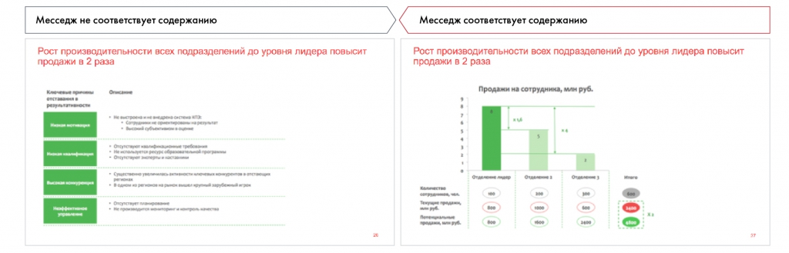

# Иллюстрация: PDF 209, изображение 1

На рисунке приведены элементы: Месседж не соответствует содержанию; Рост производительности всех подразделений до уровня лидера повысит; продажи в 2 раза; Месседж соответствует содержанию; Рост производительности всех подразделений до уровня лидера повысит. Полная текстовая расшифровка приведена отдельно; геометрия и цветовые обозначения сохранены на изображении.

Источник: [PDF 209](../../SOURCE.md#pdf-209).

Необходимая тема: [Месседжи и принцип One message per slide](../../chapters/11-presentation/05-messages.md).

## Текст изображения

> Автоматическая расшифровка. Подписи в сложных слайдах, рукописный текст и порядок колонок могут содержать ошибки OCR. Уточнения, проверенные таблицы и формулы выше имеют приоритет. Не интерпретируйте отсутствие распознанного текста как отсутствие данных в рисунке.

- Месседж не соответствует содержанию
- Рост производительности всех подразделений до уровня лидера повысит
- продажи в 2 раза
- Месседж соответствует содержанию
- Рост производительности всех подразделений до уровня лидера повысит
- продажи в 2 раза
- Продажи на сотрудника, млн руб.
- притонов, чел
- млн руб.
- продани, мин руб.
- 1 0•

## Связанные материалы

[Вернуться к теме](../../chapters/11-presentation/05-messages.md) · [Ограничения распознавания](../../meta/issues.md)
