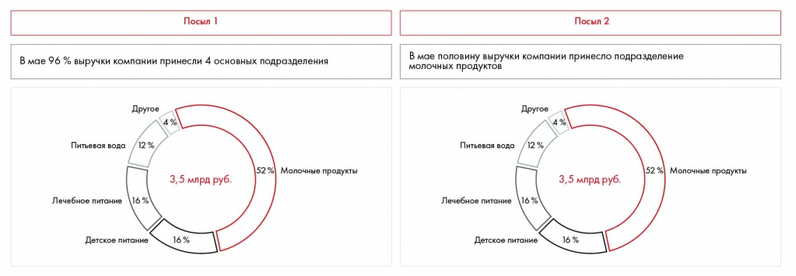

# Иллюстрация: PDF 209, изображение 2

На рисунке приведены элементы: Посыл 1; В мае 96 % выручки компании принесли 4 основных подразделения; Другов; 4%; Питьевая вода. Полная текстовая расшифровка приведена отдельно; геометрия и цветовые обозначения сохранены на изображении.

Источник: [PDF 209](../../SOURCE.md#pdf-209).

Необходимая тема: [Месседжи и принцип One message per slide](../../chapters/11-presentation/05-messages.md).

## Текст изображения

> Автоматическая расшифровка. Подписи в сложных слайдах, рукописный текст и порядок колонок могут содержать ошибки OCR. Уточнения, проверенные таблицы и формулы выше имеют приоритет. Не интерпретируйте отсутствие распознанного текста как отсутствие данных в рисунке.

- Посыл 1
- В мае 96 % выручки компании принесли 4 основных подразделения
- Другов
- 4%
- Питьевая вода
- 12 %
- 52%
- Молочные продукты
- 3,5 млрд руб.
- Лечебное питание
- \16 %
- Детское питание
- 16%
- Посыл 2
- В мае половину выручки компании принесло подразделение
- молочных продуктов
- Другов
- 4%
- Питьевая вода
- 12 %
- 52 %
- Молочные продукты
- 3,5 млрд руб.
- Лечебное питание
- 16%
- Детское питание
- 16 %

## Связанные материалы

[Вернуться к теме](../../chapters/11-presentation/05-messages.md) · [Ограничения распознавания](../../meta/issues.md)
