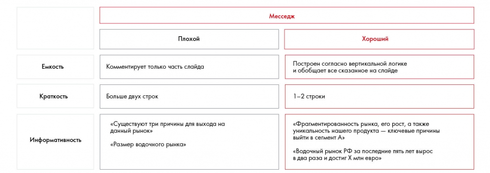

# Иллюстрация: PDF 210, изображение 1

На рисунке приведены элементы: Емкость; Краткость; Информативность; Месседж; Плохой. Полная текстовая расшифровка приведена отдельно; геометрия и цветовые обозначения сохранены на изображении.

Источник: [PDF 210](../../SOURCE.md#pdf-210).

Необходимая тема: [Месседжи и принцип One message per slide](../../chapters/11-presentation/05-messages.md).

## Текст изображения

> Автоматическая расшифровка. Подписи в сложных слайдах, рукописный текст и порядок колонок могут содержать ошибки OCR. Уточнения, проверенные таблицы и формулы выше имеют приоритет. Не интерпретируйте отсутствие распознанного текста как отсутствие данных в рисунке.

- Емкость
- Краткость
- Информативность
- Месседж
- Плохой
- Хороший
- Комментирует только часть слайда
- Построен согласно вертикальной логике
- и обобщает все сказанное на слайде
- Больше двух строк
- 1-2 строки
- «Существуют три причины для выхода на
- «Размер водочного рынка»
- «Фрагментированность рынка, его рост, а также
- уникальность нашего продукта - ключевые причины
- выйти в сегмент А»
- «Водочный рынок РФ за последние пять лет вырос
- в два раза и достиг Х млн евро»

## Связанные материалы

[Вернуться к теме](../../chapters/11-presentation/05-messages.md) · [Ограничения распознавания](../../meta/issues.md)
