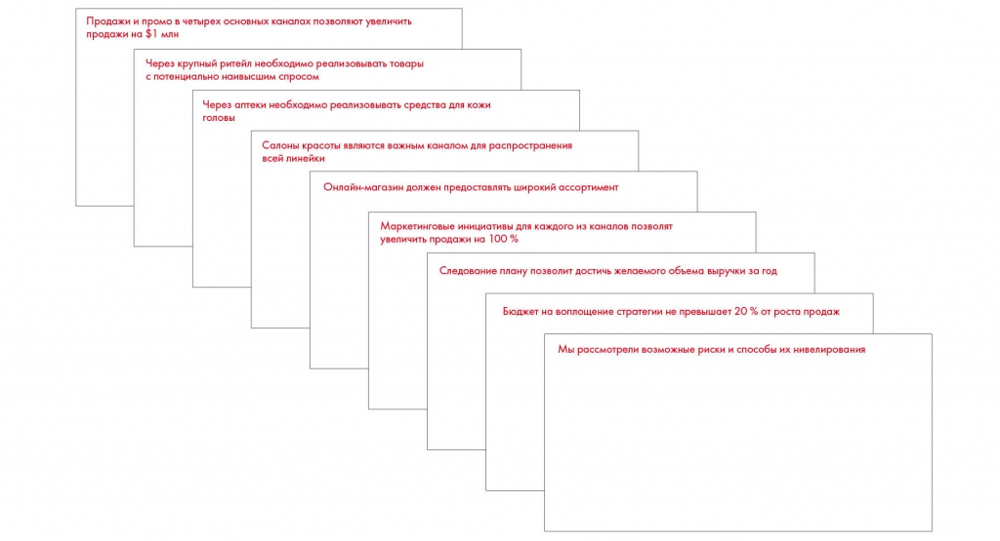

# Иллюстрация: PDF 210, изображение 2

Иллюстрация исходника: «Пример выстроенной последовательности месседжей в презентации». Подписи и числовые значения вынесены в расшифровку; порядок и связи элементов проверяются по сохранённому изображению.

Источник: [PDF 210](../../SOURCE.md#pdf-210).

Необходимая тема: [Месседжи и принцип One message per slide](../../chapters/11-presentation/05-messages.md).

## Текст изображения

> Автоматическая расшифровка. Подписи в сложных слайдах, рукописный текст и порядок колонок могут содержать ошибки OCR. Уточнения, проверенные таблицы и формулы выше имеют приоритет. Не интерпретируйте отсутствие распознанного текста как отсутствие данных в рисунке.

- Продажи и промо в четырех основных каналах позволяют увеличить
- продажи на $1 млн
- Через крупный ритейл необходимо реализовывать товары
- с потенциально наивысшим спросом
- Через аптеки необходимо реализовывать средства для кожи
- Салоны красоты являются важным каналом для распространения
- всей линейки
- Онлайн-магазин должен предоставлять широкий ассортимент
- Маркетинговые инициативы для каждого из каналов позволят
- увеличить продажи на 100 %
- Следование плану позволит достичь желавного объема выручки за год
- Бюджет на воплощение стратегии не превышает 20% от роста продаж
- Мы рассмотрели возможные риски и способы их нивелирования

## Связанные материалы

[Вернуться к теме](../../chapters/11-presentation/05-messages.md) · [Ограничения распознавания](../../meta/issues.md)
