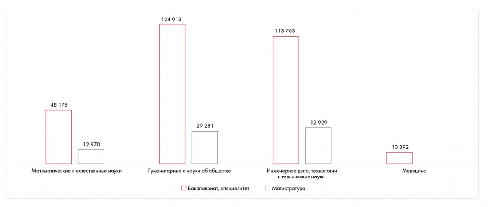

# Иллюстрация: PDF 211, изображение 1

На рисунке приведены элементы: 124913; 113763; 48 175; 29 281; 32929. Полная текстовая расшифровка приведена отдельно; геометрия и цветовые обозначения сохранены на изображении.

Источник: [PDF 211](../../SOURCE.md#pdf-211).

Необходимая тема: [Месседжи и принцип One message per slide](../../chapters/11-presentation/05-messages.md).

## Текст изображения

> Автоматическая расшифровка. Подписи в сложных слайдах, рукописный текст и порядок колонок могут содержать ошибки OCR. Уточнения, проверенные таблицы и формулы выше имеют приоритет. Не интерпретируйте отсутствие распознанного текста как отсутствие данных в рисунке.

- 124913
- 113763
- 48 175
- 29 281
- 32929
- 12970
- Математические и естественные науки
- Гуманитарные и науки об обществе
- • Бакалавриат, специалитет
- Инженерное дело, технологии
- и технические науки
- • Магистратура
- 10 392
- Медицина

## Связанные материалы

[Вернуться к теме](../../chapters/11-presentation/05-messages.md) · [Ограничения распознавания](../../meta/issues.md)
