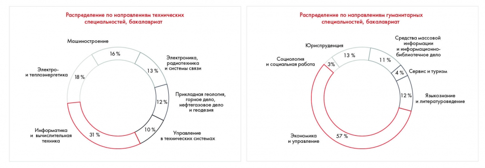

# Иллюстрация: PDF 212, изображение 1

Иллюстрация исходника: «Теперь нам стало понятнее, какие диаграммы к каким утверждениям относятся.». Подписи и числовые значения вынесены в расшифровку; порядок и связи элементов проверяются по сохранённому изображению.

Источник: [PDF 212](../../SOURCE.md#pdf-212).

Необходимая тема: [Месседжи и принцип One message per slide](../../chapters/11-presentation/05-messages.md).

## Текст изображения

> Автоматическая расшифровка. Подписи в сложных слайдах, рукописный текст и порядок колонок могут содержать ошибки OCR. Уточнения, проверенные таблицы и формулы выше имеют приоритет. Не интерпретируйте отсутствие распознанного текста как отсутствие данных в рисунке.

- Распределение по направлениям технических
- специальностей, бакалавриат
- Машиностроение
- 16 %
- 13%
- Электроника,
- радиотехника
- и системы связи
- Электро-
- и теплоэнергетика
- 18 %
- 12 %
- Прикладная геология,
- горное дело,
- нефтегазовое дело
- и геодезия
- Информатика
- и вычислительная
- 31 %
- 10%
- Управление
- в технических системах
- Социология
- и социальная работа
- Распределение по направлениям гуманитарных
- специальностей, бакалавриат
- Юриспруденция
- 13 %
- 3%
- Средства массовой
- информации
- и информационно-
- библиотечное дело
- 11 %
- 4 %
- Сервис и туризм
- 112%
- Языкознание
- и литературоведение
- Экономика
- и управление
- 57 %

## Связанные материалы

[Вернуться к теме](../../chapters/11-presentation/05-messages.md) · [Ограничения распознавания](../../meta/issues.md)
