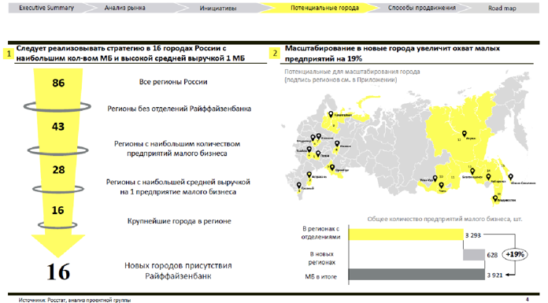

# Иллюстрация: PDF 213, изображение 2

Иллюстрация исходника: «Источник: Changellenge ≫ Cup Moscow, решение команды Tutto Bene». Подписи и числовые значения вынесены в расшифровку; порядок и связи элементов проверяются по сохранённому изображению.

Источник: [PDF 213](../../SOURCE.md#pdf-213).

Необходимая тема: [Месседжи и принцип One message per slide](../../chapters/11-presentation/05-messages.md).

## Текст изображения

> Автоматическая расшифровка. Подписи в сложных слайдах, рукописный текст и порядок колонок могут содержать ошибки OCR. Уточнения, проверенные таблицы и формулы выше имеют приоритет. Не интерпретируйте отсутствие распознанного текста как отсутствие данных в рисунке.

- execuave summary
- Анализ рынка
- Инициативы
- Следует реализовывать стратетию в 16 городах России с
- наибольшим кол-вом МБ и высокой средней выручкой 1 МБ
- 86
- Все регионы России
- Регионы без отделений Райффайзенбанка
- 43
- Регионы с наибольшим количеством
- предприятий малого бизнеса
- 28
- Регионы с наибольшей средней выручкой
- на 1 предприятие малого бизнеса
- 16
- Крупнейшие города в регионе
- 16
- Новых городов присутствия
- Райффайзенбанк
- Потенциальные города
- Способы продвижения
- Road map
- Масштабирование в новые города увеличит охват малых
- предприятий на 19%
- (подлись регионов см, в приложении,
- В пегионак с
- отделениями |
- 3 293
- ат сзанеио олоиси иишивитоси оволииох оатоо
- регионах
- МБ в итоге
- 628
- 3921+

## Связанные материалы

[Вернуться к теме](../../chapters/11-presentation/05-messages.md) · [Ограничения распознавания](../../meta/issues.md)
