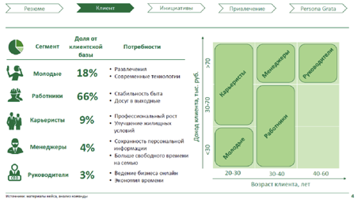

# Иллюстрация: PDF 213, изображение 3

На рисунке приведены элементы: Сегмент; каменской; горотники; Карьеристы; 18%. Полная текстовая расшифровка приведена отдельно; геометрия и цветовые обозначения сохранены на изображении.

Источник: [PDF 213](../../SOURCE.md#pdf-213).

Необходимая тема: [Месседжи и принцип One message per slide](../../chapters/11-presentation/05-messages.md).

## Текст изображения

> Автоматическая расшифровка. Подписи в сложных слайдах, рукописный текст и порядок колонок могут содержать ошибки OCR. Уточнения, проверенные таблицы и формулы выше имеют приоритет. Не интерпретируйте отсутствие распознанного текста как отсутствие данных в рисунке.

- Сегмент
- каменской
- горотники
- Карьеристы
- 18%
- 66%
- 9%
- Менеджеры
- 4%
- 3%
- > Инициативы
- Потребности
- • Современные технологии
- • Стабильность быта
- • Досуг а погоднело
- • Профессиснальный рост
- • Упрошение жилищнось
- условий
- • Сохранность персомальной
- информации
- на семью
- • Ведение бизнеса снтяйен
- • Экономия времони
- 10-70
- > Persona Grata >
- 20-30
- 4U-b

## Связанные материалы

[Вернуться к теме](../../chapters/11-presentation/05-messages.md) · [Ограничения распознавания](../../meta/issues.md)
