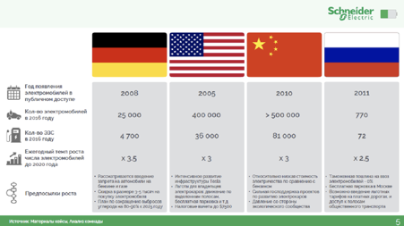

# Иллюстрация: PDF 214, изображение 1

Иллюстрация исходника: «Источник: Changellenge ≫ Cup Moscow, решение команды OldBold». Подписи и числовые значения вынесены в расшифровку; порядок и связи элементов проверяются по сохранённому изображению.

Источник: [PDF 214](../../SOURCE.md#pdf-214).

Необходимая тема: [Месседжи и принцип One message per slide](../../chapters/11-presentation/05-messages.md).

## Текст изображения

> Автоматическая расшифровка. Подписи в сложных слайдах, рукописный текст и порядок колонок могут содержать ошибки OCR. Уточнения, проверенные таблицы и формулы выше имеют приоритет. Не интерпретируйте отсутствие распознанного текста как отсутствие данных в рисунке.

- публигакм доступо
- Ежегодный темп роста
- will
- 2008
- 40 000
- 4700
- × 35
- 2005
- 400 000
- 35000
- x3
- 2010
- > 500000
- 81000
- x3
- Schneider
- 4U33
- 770
- 72
- × 2.5

## Связанные материалы

[Вернуться к теме](../../chapters/11-presentation/05-messages.md) · [Ограничения распознавания](../../meta/issues.md)
