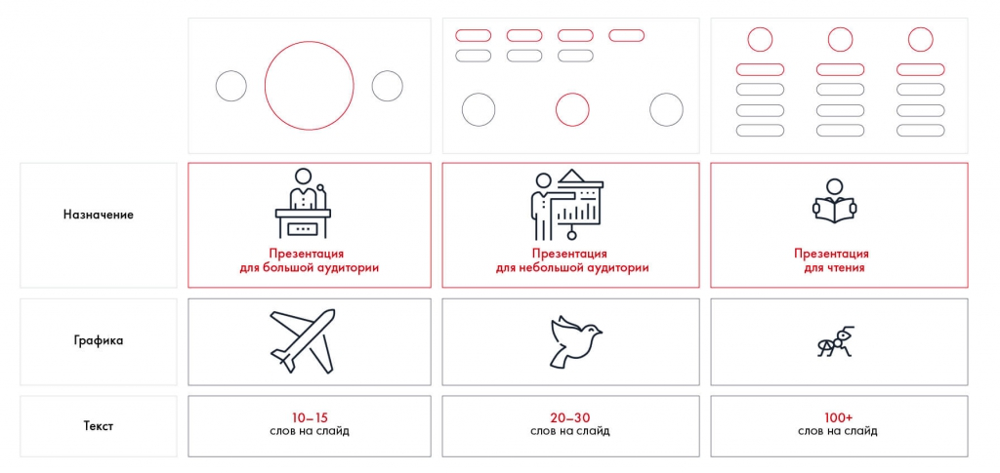

# Иллюстрация: PDF 215, изображение 1

На рисунке приведены элементы: Назначение; Графика; Текст; Презентация; для большой аудитории. Полная текстовая расшифровка приведена отдельно; геометрия и цветовые обозначения сохранены на изображении.

Источник: [PDF 215](../../SOURCE.md#pdf-215).

Необходимая тема: [Структура слайда. Часть 1](../../chapters/11-presentation/06-slide-structure.md).

## Текст изображения

> Автоматическая расшифровка. Подписи в сложных слайдах, рукописный текст и порядок колонок могут содержать ошибки OCR. Уточнения, проверенные таблицы и формулы выше имеют приоритет. Не интерпретируйте отсутствие распознанного текста как отсутствие данных в рисунке.

- Назначение
- Графика
- Текст
- Презентация
- для большой аудитории
- 10-15
- слов на слайд
- Презентация
- для небольшой аудитории
- 20-30
- слов на слайд
- Презентация
- для чтения
- 100+
- слов на слайд

## Связанные материалы

[Вернуться к теме](../../chapters/11-presentation/06-slide-structure.md) · [Ограничения распознавания](../../meta/issues.md)
