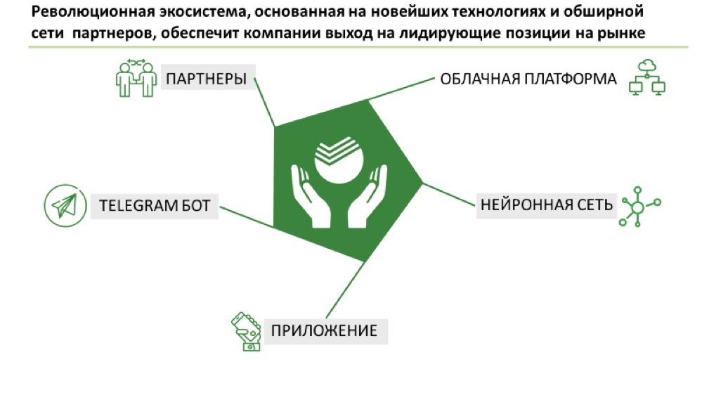

# Иллюстрация: PDF 216, изображение 1

Иллюстрация исходника: «Источник: Changellenge ≫ Cup Moscow, решение». Подписи и числовые значения вынесены в расшифровку; порядок и связи элементов проверяются по сохранённому изображению.

Источник: [PDF 216](../../SOURCE.md#pdf-216).

Необходимая тема: [Структура слайда. Часть 1](../../chapters/11-presentation/06-slide-structure.md).

## Текст изображения

> Автоматическая расшифровка. Подписи в сложных слайдах, рукописный текст и порядок колонок могут содержать ошибки OCR. Уточнения, проверенные таблицы и формулы выше имеют приоритет. Не интерпретируйте отсутствие распознанного текста как отсутствие данных в рисунке.

- Революционная экосистема, основанная на новейших технологиях и обширной
- ети партнеров, обеспечит компании выход на лидирующие позиции на рынке
- ПФ ПАРТНЕРЫ
- ОБЛАЧНАЯ ПЛАТФОРМА
- TELEGRAM БОТ
- НЕЙРОННАЯ СЕТЬ
- /
- ПРИЛОЖЕНИЕ

## Связанные материалы

[Вернуться к теме](../../chapters/11-presentation/06-slide-structure.md) · [Ограничения распознавания](../../meta/issues.md)
