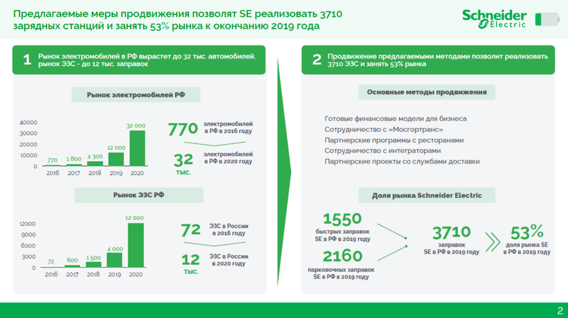

# Иллюстрация: PDF 217, изображение 1

Иллюстрация исходника: «Пример презентации для небольшой аудитории.». Подписи и числовые значения вынесены в расшифровку; порядок и связи элементов проверяются по сохранённому изображению.

Источник: [PDF 217](../../SOURCE.md#pdf-217).

Необходимая тема: [Структура слайда. Часть 1](../../chapters/11-presentation/06-slide-structure.md).

## Текст изображения

> Автоматическая расшифровка. Подписи в сложных слайдах, рукописный текст и порядок колонок могут содержать ошибки OCR. Уточнения, проверенные таблицы и формулы выше имеют приоритет. Не интерпретируйте отсутствие распознанного текста как отсутствие данных в рисунке.

- Предлагаемые меры продвижения позволят SE реализовать 3710
- зарядных станций и занять 53% рынка к окончанию 2019 года
- chneider
- Electri
- 1
- Рынок электромобилей в РФ вырастет до 32 тыс. автомобилей,
- рынок ЭЗС - до 12 тыс. заправок
- 2
- Продвижение предлагаемыми методами позволит реализовать
- 3710 33С и занять 53% рынка
- Основные методы продвижения
- 40000
- 30000
- 20000
- 10000
- 770 1800
- 4300
- 2016 2017 2018
- Рынок электромобилей РФ
- 32 000|
- электромобилей
- 770 •РФ в 2016 году
- 32
- электромобилей
- в РФ в 2020 году
- тыс.
- Готовые финансовые модели для бизнеса
- Сотрудничество с «Мосгортранс»
- Партнерские программы с ресторанами
- Сотрудничество с интеграторами
- Партнерские проекты со службами доставки
- 12 000
- 2019
- 2020
- Рынок ЭЗС РФ
- 12 000
- Доля рынка Schneider Electric
- 12000
- 9000
- 6000
- 3000
- 72
- 2016
- 600
- 2017
- 1500
- 2018
- 4 000
- 2019
- 2020
- 72 32 Роди
- в 2016 ГоДУ
- 12 30 ргоду
- в 2020 гОДУ
- тыс.
- 1550
- быстрых заправок
- SE в РФ в 2019 году
- 2160
- парковочных заправок
- SE в РФ в 2019 году
- 3710 » 53%
- заправок
- доля рынка SE
- SE в РФ в 2019 году
- в РФ в 2019 году
- 2

## Связанные материалы

[Вернуться к теме](../../chapters/11-presentation/06-slide-structure.md) · [Ограничения распознавания](../../meta/issues.md)
