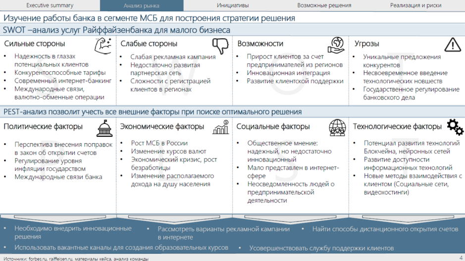

# Иллюстрация: PDF 218, изображение 1

Иллюстрация исходника: «Пример презентации для чтения. Источник: Changellenge ≫ Cup Moscow,». Подписи и числовые значения вынесены в расшифровку; порядок и связи элементов проверяются по сохранённому изображению.

Источник: [PDF 218](../../SOURCE.md#pdf-218).

Необходимая тема: [Структура слайда. Часть 1](../../chapters/11-presentation/06-slide-structure.md).

## Текст изображения

> Автоматическая расшифровка. Подписи в сложных слайдах, рукописный текст и порядок колонок могут содержать ошибки OCR. Уточнения, проверенные таблицы и формулы выше имеют приоритет. Не интерпретируйте отсутствие распознанного текста как отсутствие данных в рисунке.

- Executive summary
- Анализ рынка
- Инициативы
- Возможные решения
- Изучение работы банка в сегменте МСБ для построения стратегии решения
- SWOT -анализ услуг Райффайзенбанка для малого бизнеса
- Сильные стороны
- Слабые стороны
- • Надежность в глазах
- Слабая рекламная кампания
- потенциальных клиентов
- • Конкурентоспособные тарифы
- Недостаточно развитая
- • Современный интернет-банкинг
- партнерская сеть
- • Сложности с регистрацией
- Возможности
- • Прирост клиентов за счет
- предпринимателей из регионов
- • Инновационная интеграция
- • Развитие клиентской поддержки
- • Международные связи,
- валютно-обменные операции
- клиентов в регионах
- PEST-анализ позволит учесть все внешние факторы при поиске оптимального решения
- Политические факторы
- Экономические факторы
- ninl
- Социальные факторы
- • Перспектива внесения поправок
- в закон об открытии счетов
- • Регулирование уровня
- инфляции государством
- • Международные связи банка
- Рост МСБ в России
- Изменение курсов валют
- Экономический кризис, рост
- безработицы
- • Изменение располагаемого
- дохода на душу населения
- • Общественное мнение:
- надежный, но недостаточно
- инновационный
- • Мало представлен в интернет-
- сфере
- • Неосведомленность людей о
- предпринимательской
- деятельности
- Реализация и риски
- Угрозы
- • Уникальные предложения
- A
- конкурентов
- • Несвоевременное введение
- технологических новшеств
- • Государственное регулирование
- банковского дела
- Технологические факторы
- • Потенциал развития технологий
- Блокчейна, нейронных сетей
- • Развитие доступности
- информационных технологий
- • Новые методы взаимодействия с
- клиентом (Социальные сети,
- видеохостинги)|
- • Необходимо внедрить инновационные
- • Рассмотреть варианты рекламной кампании
- • Найти способы дистанционного открытия счетов
- решения
- в интернете
- • Использовать вакантные каналы для создания образовательных курсов • Усовершенствовать службу поддержки клиентов
- Истлиники огодслі гандал пі маталиалы кайся зналив команль!

## Связанные материалы

[Вернуться к теме](../../chapters/11-presentation/06-slide-structure.md) · [Ограничения распознавания](../../meta/issues.md)
