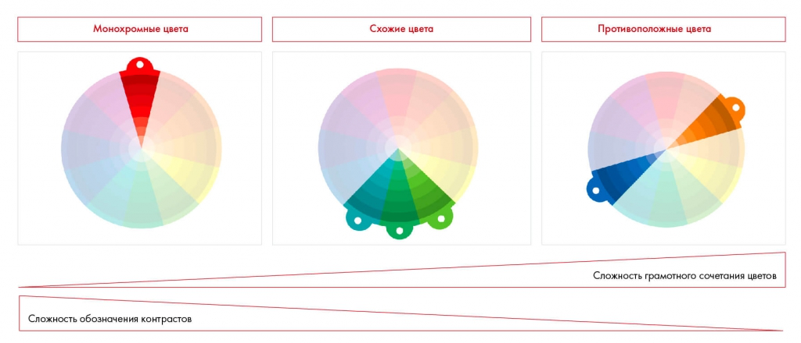

# Иллюстрация: PDF 219, изображение 1

На рисунке приведены элементы: Монохромные цвета; Схожие цвета; Противоположные цвета; Сложность грамотного сочетания цветов; Сложность обозначения контрастов. Полная текстовая расшифровка приведена отдельно; геометрия и цветовые обозначения сохранены на изображении.

Источник: [PDF 219](../../SOURCE.md#pdf-219).

Необходимая тема: [Структура слайда. Часть 1](../../chapters/11-presentation/06-slide-structure.md).

## Текст изображения

> Автоматическая расшифровка. Подписи в сложных слайдах, рукописный текст и порядок колонок могут содержать ошибки OCR. Уточнения, проверенные таблицы и формулы выше имеют приоритет. Не интерпретируйте отсутствие распознанного текста как отсутствие данных в рисунке.

- Монохромные цвета
- Схожие цвета
- Противоположные цвета
- Сложность грамотного сочетания цветов
- Сложность обозначения контрастов

## Связанные материалы

[Вернуться к теме](../../chapters/11-presentation/06-slide-structure.md) · [Ограничения распознавания](../../meta/issues.md)
