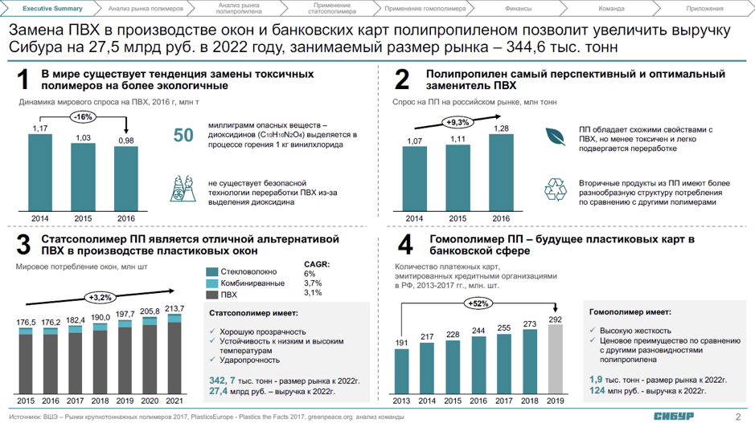

# Иллюстрация: PDF 220, изображение 1

Иллюстрация исходника: «Пример грамотного цветового оформления презентации.». Подписи и числовые значения вынесены в расшифровку; порядок и связи элементов проверяются по сохранённому изображению.

Источник: [PDF 220](../../SOURCE.md#pdf-220).

Необходимая тема: [Структура слайда. Часть 1](../../chapters/11-presentation/06-slide-structure.md).

## Текст изображения

> Автоматическая расшифровка. Подписи в сложных слайдах, рукописный текст и порядок колонок могут содержать ошибки OCR. Уточнения, проверенные таблицы и формулы выше имеют приоритет. Не интерпретируйте отсутствие распознанного текста как отсутствие данных в рисунке.

- Executive Summary
- Анализ рынка погимерсе
- Команда
- Приложения
- Замена ПВХ в производстве окон и банковских карт полипропиленом позволит увеличить выручку
- Сибура на 27,5 млрд руб. в 2022 году, занимаемый размер рынка - 344,6 тыс. тонн
- 1
- В мире существует тенденция замены токсичных
- полимеров на более экологичные
- Динамика мирового спроса на ПВХ, 2016 г, млн т
- 2
- Полипропилен самый перспективный и оптимальный
- заменитель ПВХ
- Спрос на ПП на российском рынке, млн тонн
- 1,17
- 1,03
- 0,98
- 50
- миллиграмм опасных веществ -
- диоксидинов (С1оH1сN204) выделяется в
- процессе горения 1 кг винилхлорида
- (+9,3%
- 1,28
- 1,07
- 1,11
- ПП обладает схожими свойствами с
- ПВХ, но менее токсичен и легко
- подвергается переработке
- Вторичные продукты из ПП имеют более
- разнообразную структуру потребления
- по сравнению с другими полимерами
- не существует безопасной
- технологии переработки ПВХ из-за
- выделения диоксидина
- 2014
- 2015
- 2016
- 3
- Статсополимер ПП является отличной альтернативой
- ПВХ в производстве пластиковых окон
- Мировое потребление окон, млн шт
- Стекловолокно
- Комбинирванные
- ПВХ
- CAGR:
- 6%
- 3.7%
- 3.1%
- 176,5 176,2
- 182,4
- 190,0
- 197,7 205,8 213,7
- Статсополимер имеет:
- • Хорошую прозрачность
- • Устойчивость к низким и высоким
- температурам
- • Ударопрочность
- 2015
- 2016 2017 2018
- 2019
- 2020
- 2021
- 342, 7 тыс. тонн - размер рынка к 2022г.
- 27,4 млрд руб. - выручка к 2022г.
- Источники: ВШЭ - Рынки крупнотоннажных попимеров 2017, Plastics Europe - Plastics the Facts 2017, green
- 2014
- 2015
- 2016
- 4
- Гомополимер ПП - будущее пластиковых карт в
- банковской сфере
- Количество платежных карт.
- в РФ, 2013-2017 гг., млн. шт.
- 217
- 228
- 244
- 255
- 292
- 273
- 2013 2014 2015
- 2016
- 2017
- 2018 2019
- Гомополимер имеет:
- • Высокую жесткость
- • Ценовое преимущество по сравнению
- с друтими разновидностями
- 1,9 тыс. тонн - размер рынка к 2022г.
- 124 млн руб. - выручка к 2022г.
- СИБУР
- 2

## Связанные материалы

[Вернуться к теме](../../chapters/11-presentation/06-slide-structure.md) · [Ограничения распознавания](../../meta/issues.md)
