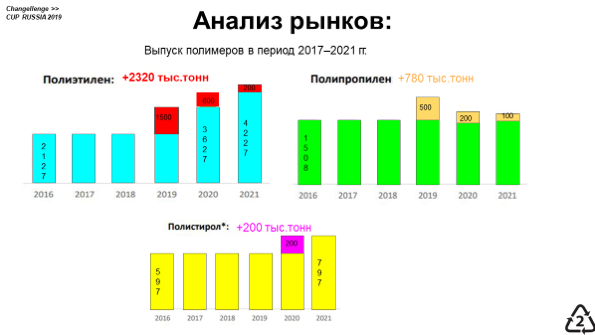

# Иллюстрация: PDF 221, изображение 1

Иллюстрация исходника: «Примеры неудачного цветового оформления презентации.». Подписи и числовые значения вынесены в расшифровку; порядок и связи элементов проверяются по сохранённому изображению.

Источник: [PDF 221](../../SOURCE.md#pdf-221).

Необходимая тема: [Структура слайда. Часть 1](../../chapters/11-presentation/06-slide-structure.md).

## Текст изображения

> Автоматическая расшифровка. Подписи в сложных слайдах, рукописный текст и порядок колонок могут содержать ошибки OCR. Уточнения, проверенные таблицы и формулы выше имеют приоритет. Не интерпретируйте отсутствие распознанного текста как отсутствие данных в рисунке.

- Changellenge »
- Анализ рынков:
- Выпуск полимеров в период 2017-2021 гг.
- Полиэтилен:
- +2320 тыс.тонн
- Полипропилен +780 тыс.тонн
- 500
- 200
- +NNN
- 2017
- 2018
- 2016
- 2017
- 2018
- 2019
- 2020
- 2021
- Полистирол*:
- +200 тыс.ТОНН
- CULO
- 2017
- N

## Связанные материалы

[Вернуться к теме](../../chapters/11-presentation/06-slide-structure.md) · [Ограничения распознавания](../../meta/issues.md)
