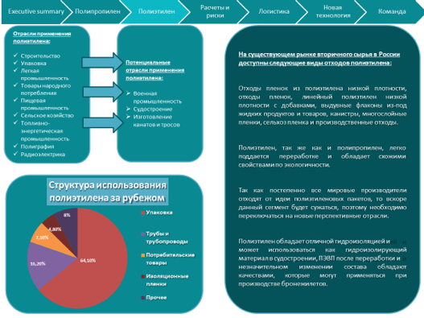

# Иллюстрация: PDF 221, изображение 2

Иллюстрация исходника: «Примеры неудачного цветового оформления презентации.». Подписи и числовые значения вынесены в расшифровку; порядок и связи элементов проверяются по сохранённому изображению.

Источник: [PDF 221](../../SOURCE.md#pdf-221).

Необходимая тема: [Структура слайда. Часть 1](../../chapters/11-presentation/06-slide-structure.md).

## Текст изображения

> Автоматическая расшифровка. Подписи в сложных слайдах, рукописный текст и порядок колонок могут содержать ошибки OCR. Уточнения, проверенные таблицы и формулы выше имеют приоритет. Не интерпретируйте отсутствие распознанного текста как отсутствие данных в рисунке.

- Exe culive summar
- • Полипровилен
- Полиэтилен
- Команда
- pHoor
- Отрасли применений
- У Стоительство
- • Упаковка
- / Легкая
- потребления
- У Пашеная
- / Сельское хозийство
- / Топлизно-
- На существующем рынке вторичного сырья п. России
- деступиы следующие видм отходов полиэтилена:
- • Военная
- промышленность
- • Судостроение
- канатов и тросое
- Отходы пленок из полиэтилена низкой плотности,
- линейный
- плотности с добавками выдувные флаконы из-под
- жидких продуктов и товаров, канистры, многослойные
- пленки, селькоз пленка и производственные отходы.
- / Полиграфия
- / Радиозлектрина
- Полиэтилен, так же как и полипропилен, легко
- переработие
- обладает
- схожими
- 15,20%
- Структура использования
- полиэтилена за рубежом
- Упаковка
- Трубы и
- трубопроводы
- • Потребительские
- товары
- • Изоляционны
- « Прочее
- Так как
- отходит от идем полиэтиленовых пакетов, то вскоре
- данный сегмент будет сужаться, поэтому необходимо
- Полизтилен обладает отличной гидроизоляцией и
- гидроизолирующий
- материал в судостроении, ПЭВП после переработки и
- НЕЗНаЧИТЕЛЬНОМ
- изменении
- wellied
- обладают
- ПрИМеНЯТЬСЯ

## Связанные материалы

[Вернуться к теме](../../chapters/11-presentation/06-slide-structure.md) · [Ограничения распознавания](../../meta/issues.md)
