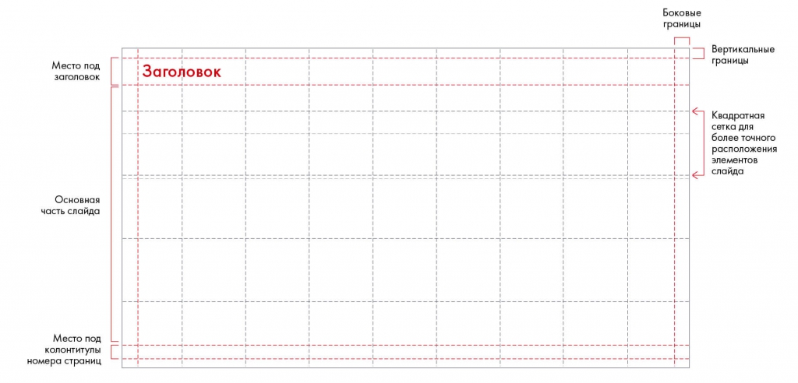

# Иллюстрация: PDF 223, изображение 1

Шаблон слайда выделяет место заголовка, рабочую область, подписи источников и колонтитулы. Постоянное расположение элементов снижает нагрузку на читателя.

Источник: [PDF 223](../../SOURCE.md#pdf-223).

Необходимая тема: [Структура слайда. Часть 1](../../chapters/11-presentation/06-slide-structure.md).

## Текст изображения

> Автоматическая расшифровка. Подписи в сложных слайдах, рукописный текст и порядок колонок могут содержать ошибки OCR. Уточнения, проверенные таблицы и формулы выше имеют приоритет. Не интерпретируйте отсутствие распознанного текста как отсутствие данных в рисунке.

- Место под
- заголовок
- Заголовок
- Основная
- часть слайда
- Место под
- колонтитулы
- номера страниц
- Боковые
- границы
- Вертикальные
- границы
- Квадратная
- сетка для
- более точного
- расположения
- элементов
- слайда

## Связанные материалы

[Вернуться к теме](../../chapters/11-presentation/06-slide-structure.md) · [Ограничения распознавания](../../meta/issues.md)
