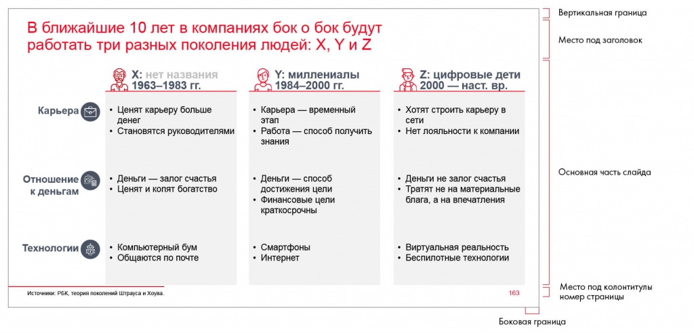

# Иллюстрация: PDF 224, изображение 1

Иллюстрация исходника: «Пример готового слайда по разметке с использованием направляющих». Подписи и числовые значения вынесены в расшифровку; порядок и связи элементов проверяются по сохранённому изображению.

Источник: [PDF 224](../../SOURCE.md#pdf-224).

Необходимая тема: [Структура слайда. Часть 1](../../chapters/11-presentation/06-slide-structure.md).

## Текст изображения

> Автоматическая расшифровка. Подписи в сложных слайдах, рукописный текст и порядок колонок могут содержать ошибки OCR. Уточнения, проверенные таблицы и формулы выше имеют приоритет. Не интерпретируйте отсутствие распознанного текста как отсутствие данных в рисунке.

- В ближайшие 10 лет в компаниях бок о бок будут
- работать три разных поколения людей: X, Y и Z
- Карьера
- Х: нет названия
- 1963-1983 гг.
- Y: миллениалы
- 1984-2000 гг.
- • Ценят карьеру больше
- денег
- • Становятся руководителями
- • Карьера - временный
- этап
- • Работа — способ получить
- знания
- Вертикальная граница
- Место под заголовок
- Z: цифровые дети
- 2000 — наст. вр.
- • Хотят строить карьеру в
- сети
- • Нет лояльности к компании
- Основная часть слайда
- Отношение
- к деньгам
- • Деньги — залог счастья
- • Ценят и копят богатство
- • Деньги — способ
- достижения цели
- • Финансовые цели
- краткосрочны
- • Деньги не залог счастья
- • Тратят не на материальные
- блага, а на впечатления
- Технологии
- • Компьютерный бум
- • Общаются по почте
- • Смартфоны
- • Интернет
- • Виртуальная реальность
- • Беспилотные технологии
- Источники: РБК, теория поколений Штрауса и Хоува.
- 163
- Место под колонтитулы
- номер страницы
- Боковая граница

## Связанные материалы

[Вернуться к теме](../../chapters/11-presentation/06-slide-structure.md) · [Ограничения распознавания](../../meta/issues.md)
