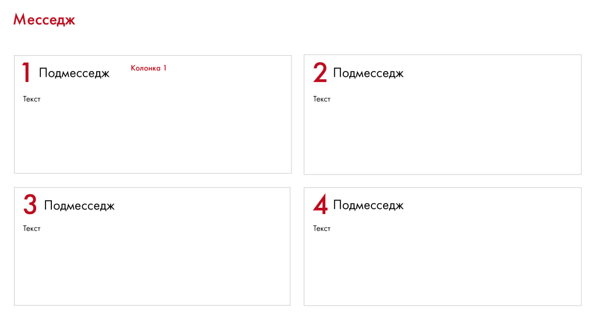

# Иллюстрация: PDF 225, изображение 2

Иллюстрация исходника: «Деление на четыре. Подходит для визуализации четырех идей, объединенных». Подписи и числовые значения вынесены в расшифровку; порядок и связи элементов проверяются по сохранённому изображению.

Источник: [PDF 225](../../SOURCE.md#pdf-225).

Необходимая тема: [Структура слайда. Часть 2](../../chapters/11-presentation/07-slide-layouts.md).

## Текст изображения

> Автоматическая расшифровка. Подписи в сложных слайдах, рукописный текст и порядок колонок могут содержать ошибки OCR. Уточнения, проверенные таблицы и формулы выше имеют приоритет. Не интерпретируйте отсутствие распознанного текста как отсутствие данных в рисунке.

- Месседж
- 1 Подмесседж
- Текст
- З Подмесседж
- Текст
- Колонка 1
- 2 Подмесседж
- Текст
- 4 Подмесседж
- Текст

## Связанные материалы

[Вернуться к теме](../../chapters/11-presentation/07-slide-layouts.md) · [Ограничения распознавания](../../meta/issues.md)
