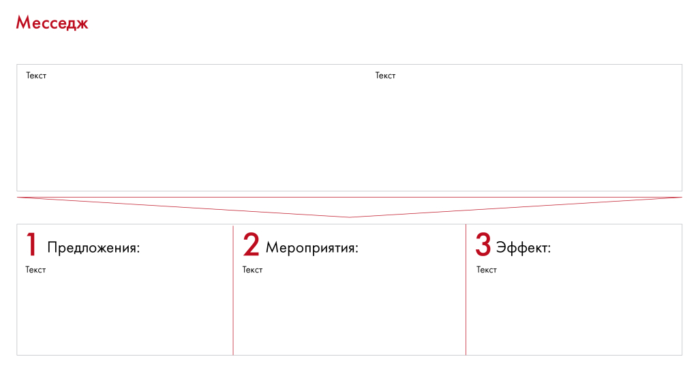

# Иллюстрация: PDF 226, изображение 1

На рисунке приведены элементы: Месседж; Текст; 1 Предложения:; Текст; 2 Мероприятия:. Полная текстовая расшифровка приведена отдельно; геометрия и цветовые обозначения сохранены на изображении.

Источник: [PDF 226](../../SOURCE.md#pdf-226).

Необходимая тема: [Структура слайда. Часть 2](../../chapters/11-presentation/07-slide-layouts.md).

## Текст изображения

> Автоматическая расшифровка. Подписи в сложных слайдах, рукописный текст и порядок колонок могут содержать ошибки OCR. Уточнения, проверенные таблицы и формулы выше имеют приоритет. Не интерпретируйте отсутствие распознанного текста как отсутствие данных в рисунке.

- Месседж
- Текст
- 1 Предложения:
- Текст
- 2 Мероприятия:
- Текст
- З Эффект:
- Текст

## Связанные материалы

[Вернуться к теме](../../chapters/11-presentation/07-slide-layouts.md) · [Ограничения распознавания](../../meta/issues.md)
