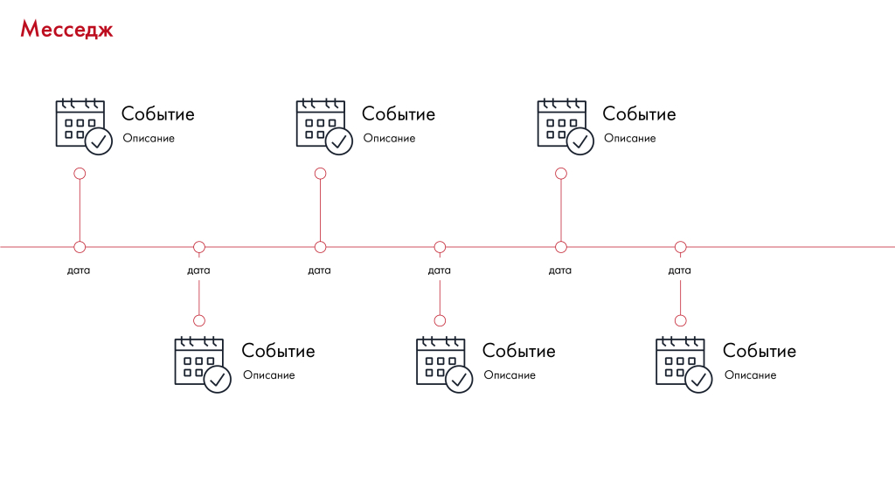

# Иллюстрация: PDF 227, изображение 2

Иллюстрация исходника: «Таймлайн. Подходит для отображения плана действий, перечисления». Подписи и числовые значения вынесены в расшифровку; порядок и связи элементов проверяются по сохранённому изображению.

Источник: [PDF 227](../../SOURCE.md#pdf-227).

Необходимая тема: [Структура слайда. Часть 2](../../chapters/11-presentation/07-slide-layouts.md).

## Текст изображения

> Автоматическая расшифровка. Подписи в сложных слайдах, рукописный текст и порядок колонок могут содержать ошибки OCR. Уточнения, проверенные таблицы и формулы выше имеют приоритет. Не интерпретируйте отсутствие распознанного текста как отсутствие данных в рисунке.

- Месседж
- Событие
- Описание
- дата
- дата
- tttt
- 000
- 00
- v
- Событие
- Описание
- дата
- дата
- Событие
- Описание
- • • •
- 000
- 00
- дата
- Событие
- Описание
- Событие
- Описание
- дата
- tit
- • 00
- 00
- Событие
- Описание

## Связанные материалы

[Вернуться к теме](../../chapters/11-presentation/07-slide-layouts.md) · [Ограничения распознавания](../../meta/issues.md)
