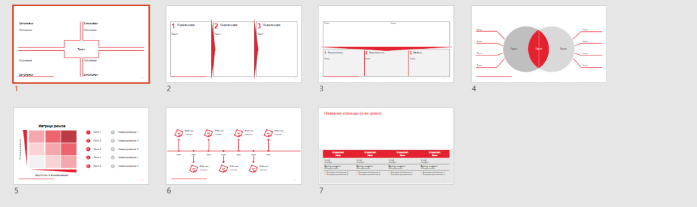

# Иллюстрация: PDF 228, изображение 1

Набор графических шаблонов расположения блоков на слайде; текста на рисунке нет. Изображения показывают, как визуально разделять рабочую область и согласовывать размеры элементов.

Источник: [PDF 228](../../SOURCE.md#pdf-228).

Необходимая тема: [Структура слайда. Часть 2](../../chapters/11-presentation/07-slide-layouts.md).

## Текст изображения

Текст не распознан. Набор графических шаблонов расположения блоков на слайде; текста на рисунке нет. Изображения показывают, как визуально разделять рабочую область и согласовывать размеры элементов.

## Связанные материалы

[Вернуться к теме](../../chapters/11-presentation/07-slide-layouts.md) · [Ограничения распознавания](../../meta/issues.md)
