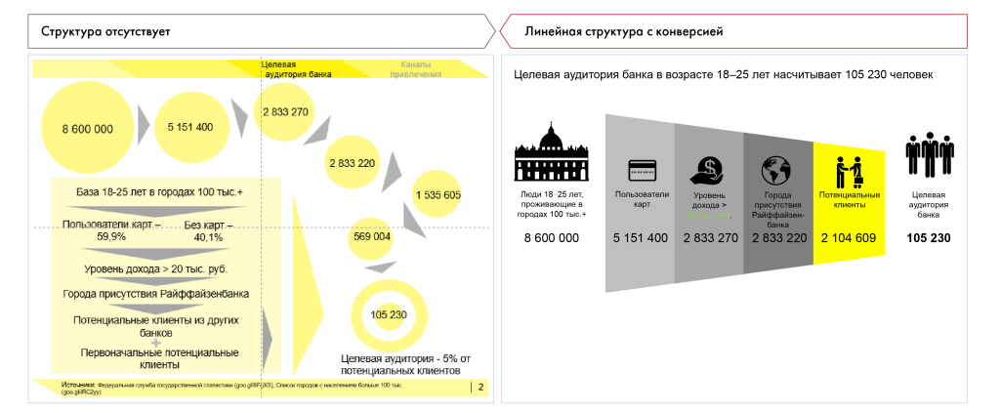

# Иллюстрация: PDF 229, изображение 1

На рисунке приведены элементы: Структура отсутствует; Линейная структура с конверсией; Целевая; аудитория банка; Каналы. Полная текстовая расшифровка приведена отдельно; геометрия и цветовые обозначения сохранены на изображении.

Источник: [PDF 229](../../SOURCE.md#pdf-229).

Необходимая тема: [Структура слайда. Часть 2](../../chapters/11-presentation/07-slide-layouts.md).

## Текст изображения

> Автоматическая расшифровка. Подписи в сложных слайдах, рукописный текст и порядок колонок могут содержать ошибки OCR. Уточнения, проверенные таблицы и формулы выше имеют приоритет. Не интерпретируйте отсутствие распознанного текста как отсутствие данных в рисунке.

- Структура отсутствует
- Линейная структура с конверсией
- Целевая
- аудитория банка
- Каналы
- привлечения
- Целевая аудитория банка в возрасте 18-25 лет насчитывает 105 230 человек
- :2 833 270
- 8 600 000
- 5 151 400
- 2 833 220
- База 18-25 лет в городах 100 тыс.+
- 1 535 605
- Пользователи карт.-
- 59,9%
- Без карт.-
- 40.1%
- Уровень дохода > 20 тыс. руб.
- Города присутствия Райффайзенбанка
- Потенциальные клиенты из других
- банков
- Первоначальные потенциальные
- клиенты
- 569 004
- HRHH
- Люди 18-25 лет.
- проживающию в
- городах 100 тыю.+
- 8 600 000
- карт
- Уровень
- дохода >
- Города
- 5 151 400
- 2 833 270
- Райсовизен
- банка
- 2 833 220
- Потенциальные
- ADIPTEYT FEH
- 2 104 609
- Целовая
- банка
- 105 230
- 105 230
- (200 gl RC2y)))
- Целевая аудитория - 5% от
- потенциальных клиентов
- 12

## Связанные материалы

[Вернуться к теме](../../chapters/11-presentation/07-slide-layouts.md) · [Ограничения распознавания](../../meta/issues.md)
