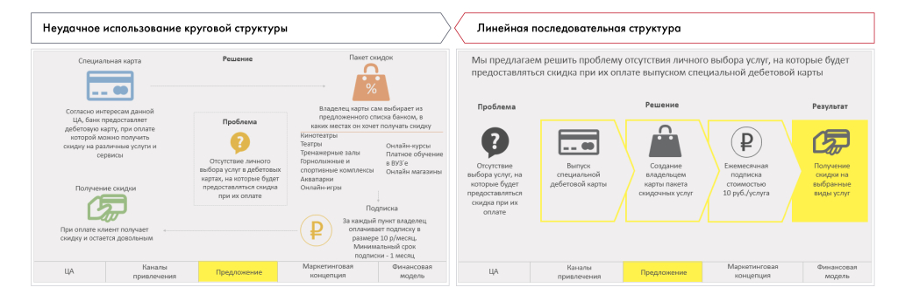

# Иллюстрация: PDF 229, изображение 2

На рисунке приведены элементы: Неудачное использование круговой структуры; Специальная карта; Пакет скидок; Согласно интересам данной; ца, банк предоставлет. Полная текстовая расшифровка приведена отдельно; геометрия и цветовые обозначения сохранены на изображении.

Источник: [PDF 229](../../SOURCE.md#pdf-229).

Необходимая тема: [Структура слайда. Часть 2](../../chapters/11-presentation/07-slide-layouts.md).

## Текст изображения

> Автоматическая расшифровка. Подписи в сложных слайдах, рукописный текст и порядок колонок могут содержать ошибки OCR. Уточнения, проверенные таблицы и формулы выше имеют приоритет. Не интерпретируйте отсутствие распознанного текста как отсутствие данных в рисунке.

- Неудачное использование круговой структуры
- Специальная карта
- Пакет скидок
- Согласно интересам данной
- ца, банк предоставлет
- дебетовую карту, при оплате
- которой можно получить
- скидку на различные услути и
- THAT-DE
- Проблема
- выбора услуг в дебетовых
- Получение скидки
- Владелец карты сам выбирает из
- предложенного списка банком, в
- наних местах он хочет получати снидму
- Кинотеатры
- Тренажерные залы
- спортивнию компленст
- Аквапарки
- Онлайн-игры
- Онлайн-курсы
- платное обучений
- в ВУЗ'е
- онлайн магазины
- При оплате клиент получает
- скидку и остается довольным
- ЦА
- Маркетинговая
- Подписка
- За каждый пункт владелец
- оплачивзет подлиску в
- размере 10 р/месяц.
- Минимальный срок
- подлиски - 1 месяц
- Финансовая
- помалочення
- Предложение
- Линейная последовательная структура
- Мы предлагаем решить проблему отсутствия личного выбора услуг, на которые будет
- предоставляться скидка при их оплате выпуском специальной дебетовой карты
- Проблема
- Решение
- Результат
- Отсутствие
- выбора услуг, на
- которые будет
- предоставляться
- скинка пих
- оплате
- Выпуск
- специальной
- дебетовой карты
- Создание!
- карты пакета
- скидочных услуг
- стоимостью
- 10 руб./услуга
- Получение
- скинси на
- выбранные
- видь усЛуГ
- ЦА
- Каналья
- привлечения
- Предложение
- Маркотинговая
- конценших
- Финзнсовал
- модель

## Связанные материалы

[Вернуться к теме](../../chapters/11-presentation/07-slide-layouts.md) · [Ограничения распознавания](../../meta/issues.md)
