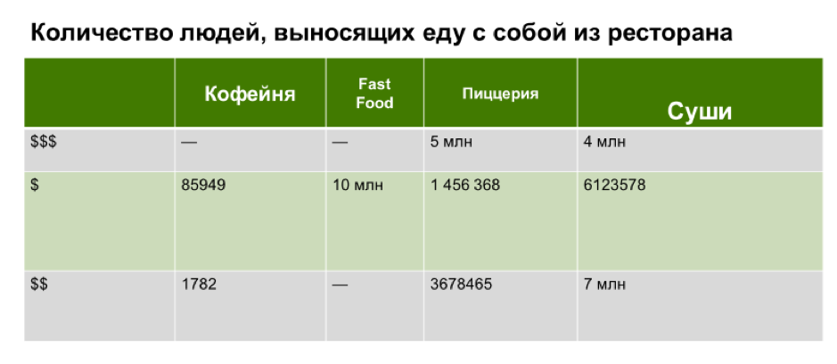

# Иллюстрация: PDF 234, изображение 1

Иллюстрация исходника: «Неудачное оформление таблицы». Подписи и числовые значения вынесены в расшифровку; порядок и связи элементов проверяются по сохранённому изображению.

Источник: [PDF 234](../../SOURCE.md#pdf-234).

Необходимая тема: [Средства визуализации: схемы, карты, таблицы и списки](../../chapters/11-presentation/08-visual-tools.md).

## Текст изображения

> Автоматическая расшифровка. Подписи в сложных слайдах, рукописный текст и порядок колонок могут содержать ошибки OCR. Уточнения, проверенные таблицы и формулы выше имеют приоритет. Не интерпретируйте отсутствие распознанного текста как отсутствие данных в рисунке.

- Количество людей, выносящих еду с собой из ресторана
- Кофейня
- Fast
- Food
- Пиццерия
- Суши
- $$$
- $
- -
- 85949
- -
- 10 млн
- 5 млн
- 1 456 368
- 4 млн
- 6123578
- $$
- 1782
- 3678465
- 7 млн

## Связанные материалы

[Вернуться к теме](../../chapters/11-presentation/08-visual-tools.md) · [Ограничения распознавания](../../meta/issues.md)
