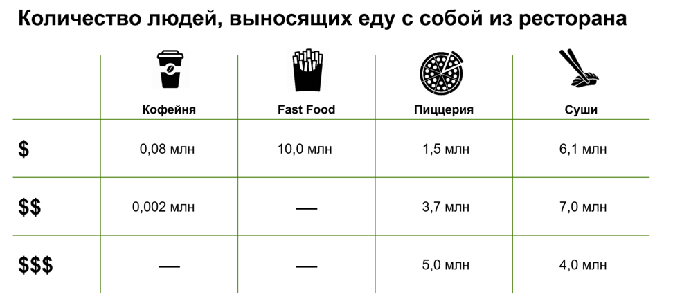

# Иллюстрация: PDF 235, изображение 1

Иллюстрация исходника: «Удачное оформление таблицы». Подписи и числовые значения вынесены в расшифровку; порядок и связи элементов проверяются по сохранённому изображению.

Источник: [PDF 235](../../SOURCE.md#pdf-235).

Необходимая тема: [Средства визуализации: схемы, карты, таблицы и списки](../../chapters/11-presentation/08-visual-tools.md).

## Текст изображения

> Автоматическая расшифровка. Подписи в сложных слайдах, рукописный текст и порядок колонок могут содержать ошибки OCR. Уточнения, проверенные таблицы и формулы выше имеют приоритет. Не интерпретируйте отсутствие распознанного текста как отсутствие данных в рисунке.

- Количество людей, выносящих еду с собой из ресторана
- Кофейня
- 0,08 млн
- $
- $$
- $$$
- 0,002 млн
- -
- Fast Food
- 10,0 млн
- -
- -
- Пиццерия
- 1,5 млн
- Суши
- 6,1 млн
- 3,7 млн
- 7,0 млн
- 5,0 млн
- 4,0 млн

## Связанные материалы

[Вернуться к теме](../../chapters/11-presentation/08-visual-tools.md) · [Ограничения распознавания](../../meta/issues.md)
