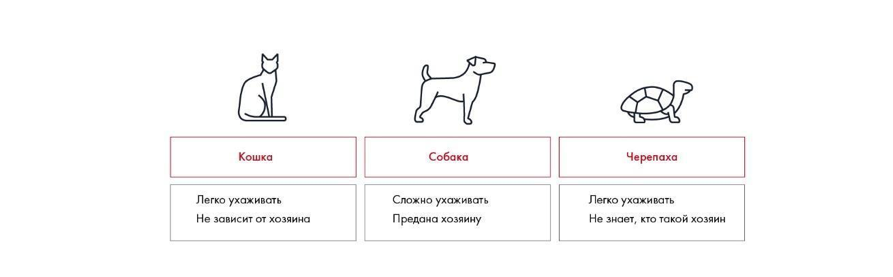

# Иллюстрация: PDF 235, изображение 2

Иллюстрация исходника: «Пример использования колонок». Подписи и числовые значения вынесены в расшифровку; порядок и связи элементов проверяются по сохранённому изображению.

Источник: [PDF 235](../../SOURCE.md#pdf-235).

Необходимая тема: [Средства визуализации: схемы, карты, таблицы и списки](../../chapters/11-presentation/08-visual-tools.md).

## Текст изображения

> Автоматическая расшифровка. Подписи в сложных слайдах, рукописный текст и порядок колонок могут содержать ошибки OCR. Уточнения, проверенные таблицы и формулы выше имеют приоритет. Не интерпретируйте отсутствие распознанного текста как отсутствие данных в рисунке.

- Кошка
- Легко ухаживать
- Не зависит от хозяина
- Собака
- Сложно ухаживать
- Предана хозяину
- Черепаха
- Легко ухаживать
- Не знает, кто такой хозяин

## Связанные материалы

[Вернуться к теме](../../chapters/11-presentation/08-visual-tools.md) · [Ограничения распознавания](../../meta/issues.md)
