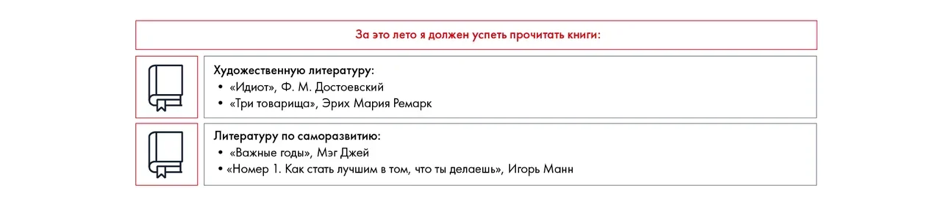

# Иллюстрация: PDF 236, изображение 1

Иллюстрация исходника: «Пример списка». Подписи и числовые значения вынесены в расшифровку; порядок и связи элементов проверяются по сохранённому изображению.

Источник: [PDF 236](../../SOURCE.md#pdf-236).

Необходимая тема: [Средства визуализации: схемы, карты, таблицы и списки](../../chapters/11-presentation/08-visual-tools.md).

## Текст изображения

> Автоматическая расшифровка. Подписи в сложных слайдах, рукописный текст и порядок колонок могут содержать ошибки OCR. Уточнения, проверенные таблицы и формулы выше имеют приоритет. Не интерпретируйте отсутствие распознанного текста как отсутствие данных в рисунке.

- За это лето я должен успеть прочитать книги:
- Художественную литературу:
- • «Идиот», Ф. М. Достоевский
- • «Три товарища», Эрих Мария Ремарк
- Литературу по саморазвитию:
- • «Важные годы», Мэг Джей
- • «Номер 1. Как стать лучшим в том. что ты пелаешь». Игорь Манн
- • «Номер 1. Как стать лучшим в том, что ты делаешь», Игорь Манн

## Связанные материалы

[Вернуться к теме](../../chapters/11-presentation/08-visual-tools.md) · [Ограничения распознавания](../../meta/issues.md)
