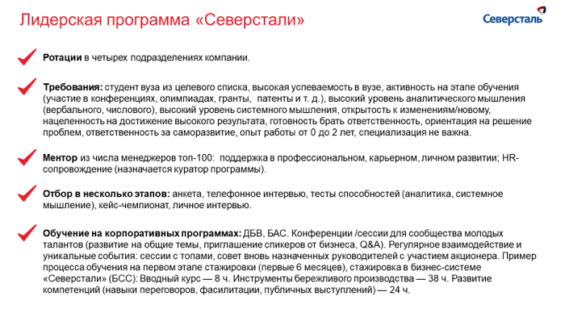

# Иллюстрация: PDF 236, изображение 2

На рисунке приведены элементы: Лидерская программа «Северстали»; Северсталь; У Ротации в четырех подразделениях компании.; Требования: студент вуза из целевого списка, высокая успеваемость в вузе, активность на этапе обучения; (участие в конференциях, олимпиадах, гранты, патенты и т. д.), высокий уровень аналитического мышления. Полная текстовая расшифровка приведена отдельно; геометрия и цветовые обозначения сохранены на изображении.

Источник: [PDF 236](../../SOURCE.md#pdf-236).

Необходимая тема: [Средства визуализации: схемы, карты, таблицы и списки](../../chapters/11-presentation/08-visual-tools.md).

## Текст изображения

> Автоматическая расшифровка. Подписи в сложных слайдах, рукописный текст и порядок колонок могут содержать ошибки OCR. Уточнения, проверенные таблицы и формулы выше имеют приоритет. Не интерпретируйте отсутствие распознанного текста как отсутствие данных в рисунке.

- Лидерская программа «Северстали»
- Северсталь
- У Ротации в четырех подразделениях компании.
- Требования: студент вуза из целевого списка, высокая успеваемость в вузе, активность на этапе обучения
- (участие в конференциях, олимпиадах, гранты, патенты и т. д.), высокий уровень аналитического мышления
- вербального, числого), высокий уровень систого моления, открытость к изменениям/новому.
- нацеленность на достижение высокого результата, готовность брать ответственность, ориентация на решение
- проблем, ответственность за саморазвитие, опыт работы от 0 до 2 лет, специализация не важна.
- Ментор из числа менеджеров топ-100: поддержка в профессиональном, карьерном, личном развитии; HR-
- сопровождение (назначается куратор программы).
- Отбор в несколько этапов: анкета, телефонное интервью, тесты способностей (аналитика, системное
- мышление), кейс-чемпионат, личное интервью.
- Обучение на корпоративных программах: ДБВ, БАС. Конференции /сессии для сообщества молодых
- талантов (развитие на общие темы, приглашение спикеров от бизнеса, Q&A). Регулярное взаимодействие и
- уникальные события: сессии с топами, совет вновь назначенных руководителей с участием акционера. Пример
- процесса обучения на первом этапе стажировки (первые 6 месяцев), стажировка в бизнес-системе
- «Северстали» (БСС): Вводный курс — 8 ч. Инструменты бережливого производства — 38 ч. Развитие
- компетенций (навыки переговоров, фасилитации, публичных выступлений) — 24 ч.

## Связанные материалы

[Вернуться к теме](../../chapters/11-presentation/08-visual-tools.md) · [Ограничения распознавания](../../meta/issues.md)
