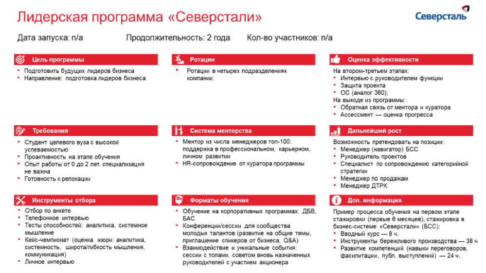

# Иллюстрация: PDF 237, изображение 1

На рисунке приведены элементы: Лидерская программа «Северстали»; Дата запуска: п/а; Продолжительность: 2 года; © Цель программы; • Подготовить будущих лидеров бизнеса. Полная текстовая расшифровка приведена отдельно; геометрия и цветовые обозначения сохранены на изображении.

Источник: [PDF 237](../../SOURCE.md#pdf-237).

Необходимая тема: [Средства визуализации: схемы, карты, таблицы и списки](../../chapters/11-presentation/08-visual-tools.md).

## Текст изображения

> Автоматическая расшифровка. Подписи в сложных слайдах, рукописный текст и порядок колонок могут содержать ошибки OCR. Уточнения, проверенные таблицы и формулы выше имеют приоритет. Не интерпретируйте отсутствие распознанного текста как отсутствие данных в рисунке.

- Лидерская программа «Северстали»
- Дата запуска: п/а
- Продолжительность: 2 года
- © Цель программы
- • Подготовить будущих лидеров бизнеса
- • Направление: подготовка лидеров бизнеса
- 3. Ротации
- Ротации в четырех подразделениях
- компании.
- Северсталь
- Кол-во участников: п/а
- Требования
- • Студент целевого вуза с высокой
- успеваемостью
- • Проактивность на этапе обучения
- • Опыт работы от 0 до 2 лет, специализация
- не важна
- • Готовность к релокации
- Х Инструменты отбора
- • Отбор по анкете
- • Телефонное интервью
- • Тесты способностей: аналитика, системное
- Мышление
- • Кейс-чемпионат (оценка жюри: аналитика,
- системность, широта/тибкость мышления.
- коммуникация)
- • Личное интервью
- •* Система менторства
- • Ментор из числа менеджеров топ-100:
- поддержка в профессиональном, карьерном,
- личном развитии
- • HR-сопровождение от куратора программы
- Оо Форматы обучения
- • Обучение на корпоративных программах: ДБВ,
- БАС
- • Конференции/сессии для сообщества
- молодых талантов (развитие на общие темы,
- приглашение спикеров от бизнеса, Q&A)
- • Взаимодействие и уникальные события:
- сессии с топами, советом вновь назначенных
- руководителей с участием акционера
- Оценка эффективности
- На втором-третьем этапах:
- • Интервью с руководителем функции
- • Защита проекта
- • ОС (аналог 360);
- На выходе из программы:
- • Обратная связь от ментора и куратора
- • Ассессмент — оценка прогресса
- Дальнейший рост
- Возможность претендовать на позиции:
- • Менеджер (навигатор) БСС
- • Руководитель проектов
- • Специалист по сопровождению категорийной
- стратегии
- • Менеджер по продажам
- • Менеджер ДТРК
- (і) Доп. информация
- Пример процесса обучения на первом этапе
- стажировки (первые 6 месяцев), стажировка в
- бизнес-системе «Северстали» (БСС):
- • Вводный курс — 8 ч.
- • Инструменты бережливого производства — 38 ч
- • Развитие компетенций (навыки переговоров,
- фасилитации, публ. выступлений) — 24 ч.

## Связанные материалы

[Вернуться к теме](../../chapters/11-presentation/08-visual-tools.md) · [Ограничения распознавания](../../meta/issues.md)
