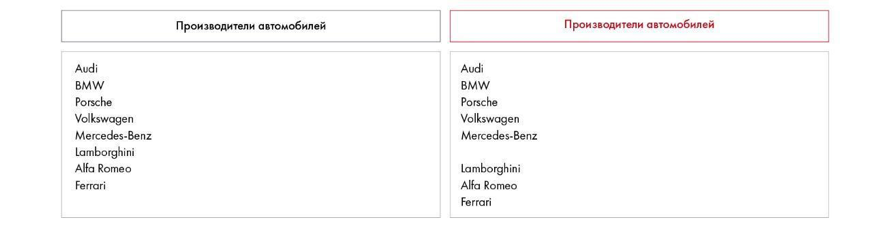

# Иллюстрация: PDF 242, изображение 1

На рисунке приведены элементы: Производители автомобилей; Производители автомобилей; Audi; BMW; Porsche. Полная текстовая расшифровка приведена отдельно; геометрия и цветовые обозначения сохранены на изображении.

Источник: [PDF 242](../../SOURCE.md#pdf-242).

Необходимая тема: [Дизайн. Часть 1](../../chapters/11-presentation/09-design.md).

## Текст изображения

> Автоматическая расшифровка. Подписи в сложных слайдах, рукописный текст и порядок колонок могут содержать ошибки OCR. Уточнения, проверенные таблицы и формулы выше имеют приоритет. Не интерпретируйте отсутствие распознанного текста как отсутствие данных в рисунке.

- Производители автомобилей
- Производители автомобилей
- Audi
- BMW
- Porsche
- Volkswagen
- Mercedes-Benz
- Lamborghini
- Alfa Romeo
- Ferrari
- Audi
- BMW
- Porsche
- Volkswagen
- Mercedes-Benz
- Lamborghini
- Alfa Romeo
- Ferrari

## Связанные материалы

[Вернуться к теме](../../chapters/11-presentation/09-design.md) · [Ограничения распознавания](../../meta/issues.md)
