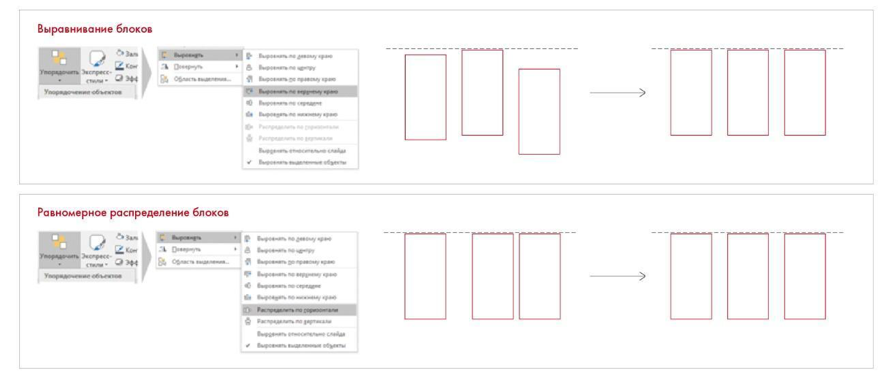

# Иллюстрация: PDF 244, изображение 2

На рисунке приведены элементы: Выравнивание блокоя; Равномерное распределение блоков; О 3е. Полная текстовая расшифровка приведена отдельно; геометрия и цветовые обозначения сохранены на изображении.

Источник: [PDF 244](../../SOURCE.md#pdf-244).

Необходимая тема: [Дизайн. Часть 1](../../chapters/11-presentation/09-design.md).

## Текст изображения

> Автоматическая расшифровка. Подписи в сложных слайдах, рукописный текст и порядок колонок могут содержать ошибки OCR. Уточнения, проверенные таблицы и формулы выше имеют приоритет. Не интерпретируйте отсутствие распознанного текста как отсутствие данных в рисунке.

- Выравнивание блокоя
- Равномерное распределение блоков
- О 3е

## Связанные материалы

[Вернуться к теме](../../chapters/11-presentation/09-design.md) · [Ограничения распознавания](../../meta/issues.md)
