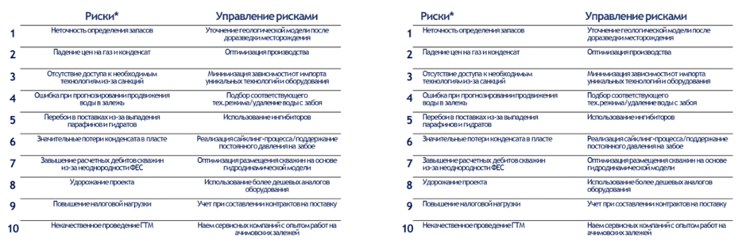

# Иллюстрация: PDF 245, изображение 1

Иллюстрация исходника: «В таблице слева выравнивание текста настроено по центру. В этом случае оба края». Подписи и числовые значения вынесены в расшифровку; порядок и связи элементов проверяются по сохранённому изображению.

Источник: [PDF 245](../../SOURCE.md#pdf-245).

Необходимая тема: [Дизайн. Часть 1](../../chapters/11-presentation/09-design.md).

## Текст изображения

> Автоматическая расшифровка. Подписи в сложных слайдах, рукописный текст и порядок колонок могут содержать ошибки OCR. Уточнения, проверенные таблицы и формулы выше имеют приоритет. Не интерпретируйте отсутствие распознанного текста как отсутствие данных в рисунке.

- 1
- 2
- 3
- 10
- Риски*
- Неточность определения запасов
- Падение цен на газ и конденсат
- Отсутствие поступа к необходимым
- технологиямиз-за санкций
- Ошибка при прогнозировании продвинения
- Перебои в поставках из-за выпадення
- значительные потери коноенсата в пласте
- Завышение расчетных дебитов ованин
- из-за неоднородности ФЕС
- Удорожание проекта
- Повышение налоговой нагрузо!
- Некачественное проведение ГМ
- Управление рисками
- Уточнение геологической модели после
- доразоедки месторожденяя
- Оптимизеция производства
- Минимизация зависимостиот импорта
- уникальных технологиии оборудования
- Подбор соответствующего
- тех.режима/удаление воды с забоя
- пололожвнисинионтаров
- Реализация сайклинг-процесса/поддержание
- постоянного давления на забое
- Оптими зация размещения скважин на основе
- гидродинамической модели
- оборудования
- учет пом составленим контрактов на пОставку
- Наем сервисных компаний с опытом работ не
- Риски*
- 1 Неточность определения запаков
- 2 Падение цен на газ и конденсат
- 3 Отсутствие доступа к необходимых
- технологиям из-за санкций
- 4 Ошибка при прогнозировании продвижения
- ворі в залежь
- 5 Перебои в поставках ис-за выпадення
- 6 Значительные потери конденсата в пласте
- Завышение расчетных дебитов скванин
- из-за неоднородности ФЕС
- 8 Удорожание проекта
- 9 Повышение нелоговой негрузон
- 10 Некачественное проведение ГТМ
- Управление рисками
- Уточнение геологической модели после
- доразведки месторожденя
- Оптимизация производства
- Минимизация зависимостиот импорта
- уникальных технологиии оборудования
- Подбор соответствующего
- тех.режима/удаление воды с забоя
- Использование ингибиторов
- Оптимизация размещения скважин на основе
- пидродинамической модели
- полользованис солее дошевь аналог 08
- оборудования
- учет пои составлени контрактов на поставку
- Наем сервисных компаний с опытом работ на
- ачемовских залежей

## Связанные материалы

[Вернуться к теме](../../chapters/11-presentation/09-design.md) · [Ограничения распознавания](../../meta/issues.md)
