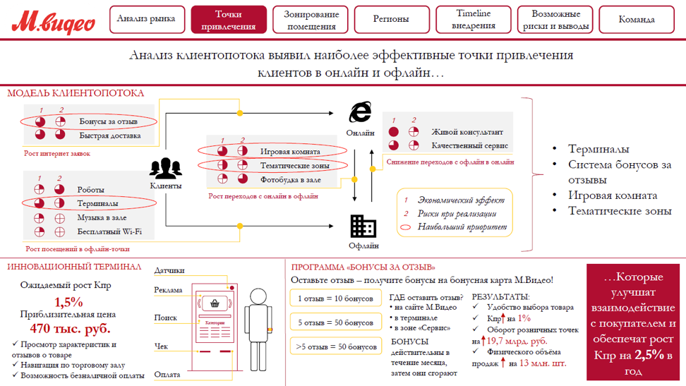

# Иллюстрация: PDF 248, изображение 1

На рисунке приведены элементы: М.видео; Анализ рынка; Точки; привлечения; Зонирование. Полная текстовая расшифровка приведена отдельно; геометрия и цветовые обозначения сохранены на изображении.

Источник: [PDF 248](../../SOURCE.md#pdf-248).

Необходимая тема: [Дизайн. Часть 2](../../chapters/11-presentation/10-design-practice.md).

## Текст изображения

> Автоматическая расшифровка. Подписи в сложных слайдах, рукописный текст и порядок колонок могут содержать ошибки OCR. Уточнения, проверенные таблицы и формулы выше имеют приоритет. Не интерпретируйте отсутствие распознанного текста как отсутствие данных в рисунке.

- М.видео
- Анализ рынка
- Точки
- привлечения
- Зонирование
- помещения
- Регионы
- Timeline
- внедрення
- Возможные
- риски и выводы
- Команда
- Анализ клиентопотока выявил наиболее эффективные точки привлечения
- клиентов в онлайн и офлайн...
- МОДЕЛЬ КЛИЕНТОПОТОКА
- Бонусы за отзыв
- Быстрая доставка
- Онлайн
- Рост литерлет злевок:
- Живой консультант
- Качественный сервис
- Слижение переходов с офлайн в онлайн
- Роботы
- Терзаналы
- Музыка в зале
- Бесплатный Wi-Fi
- Клиенты
- Игровая комната
- Тематические зоны
- Фотобудка в зале
- Рост переходов с оплайн в офлайн
- •
- Экономический эффект
- 2 Риски при реализации
- • Наибольший приоритет
- • Терминалы
- • Система бонусов за
- отзыВы
- • Игровая комната
- • Тематические зоны
- Рост посещений в офлайн-тотат
- Офлаїн
- ИННОВАЦИОННЫЙ ТЕРМИНАЛ
- Датчики
- Ожидаемый рост Кпр
- 1,5%
- Приблизительная цена
- 470 тыс. руб.
- • Просмотр характеристик #
- отзывов о товаре
- • Навигация по торговому заду
- / Возможность безналичной оплаты
- Реклама
- Понск
- Чек
- ПРОГРАММА «БОНУСЫ ЗА ОТЗЫВ»
- Оставьте отзыв - получите бонусы на бонусная карта М.Видео!
- 1 отзыв = 10 бонусов
- ГДЕ оставить отзыв? РЕЗУЛЬТАТЫ:
- • на саїте М.Видео
- • Удобство выбора товара
- • в терминале
- 5 отзыв = 50 бонусов
- • Knpf на 1%
- • в зоне «Сервис»
- • Оборот розничных точек
- БОНУСЫ
- на $ 19,7 млрд. руб.
- >5 отзыв = 50 бонусов
- деиствительны в
- • Физического объема
- продаж Т на 13 млн. шт.
- Оплата
- затем они сгорают
- ...Которые
- улучшат
- взаимодействие
- с покупателем и
- обеспечат рост
- Кпр на 2,5% в
- год

## Связанные материалы

[Вернуться к теме](../../chapters/11-presentation/10-design-practice.md) · [Ограничения распознавания](../../meta/issues.md)
