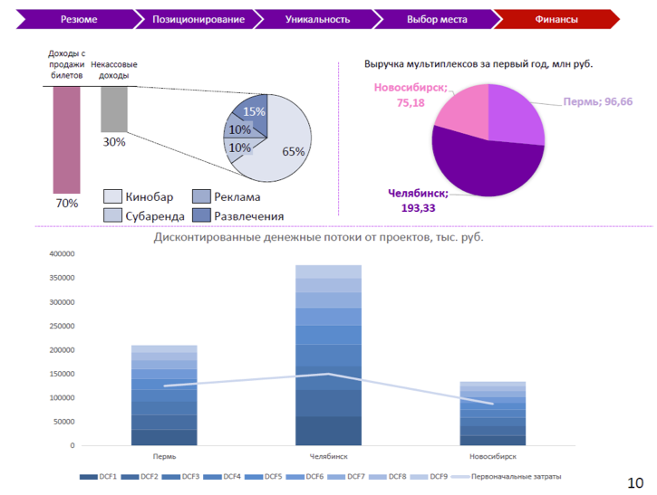

# Иллюстрация: PDF 248, изображение 2

На рисунке приведены элементы: Резюме; Позиционирование; Уникальность; Выбор места; Финансы. Полная текстовая расшифровка приведена отдельно; геометрия и цветовые обозначения сохранены на изображении.

Источник: [PDF 248](../../SOURCE.md#pdf-248).

Необходимая тема: [Дизайн. Часть 2](../../chapters/11-presentation/10-design-practice.md).

## Текст изображения

> Автоматическая расшифровка. Подписи в сложных слайдах, рукописный текст и порядок колонок могут содержать ошибки OCR. Уточнения, проверенные таблицы и формулы выше имеют приоритет. Не интерпретируйте отсутствие распознанного текста как отсутствие данных в рисунке.

- Резюме
- Позиционирование
- Уникальность
- Выбор места
- Финансы
- Доходы с
- продажи Некассовые
- билетов
- ДохоДы
- Выручка мультиплексов за первый год, млн руб.
- Новосибирск;.
- 75,18
- Пермь; 96,66
- 30%(
- 15%
- 10% \
- 10%
- 65%
- 70%
- | Кинобар
- Субаренда
- Реклама
- Челябинск;
- 193,33
- Развлечения
- Дисконтированные денежные потоки от проектов, тыс. руб.
- 400000
- SSUUUU
- 300000
- 250000
- ATUUUU
- 150000
- 100000
- 50000
- Челебинск
- SOKS-SHASHOST
- 10

## Связанные материалы

[Вернуться к теме](../../chapters/11-presentation/10-design-practice.md) · [Ограничения распознавания](../../meta/issues.md)
