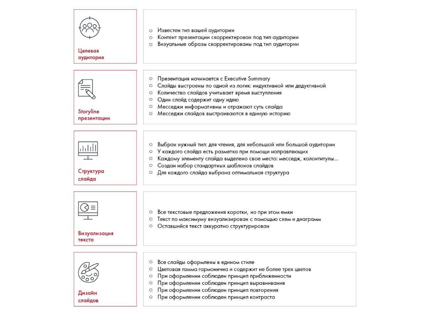

# Иллюстрация: PDF 250, изображение 1

На рисунке приведены элементы: Целевая; аудитория; Storyline; презентации; Структура. Полная текстовая расшифровка приведена отдельно; геометрия и цветовые обозначения сохранены на изображении.

Источник: [PDF 250](../../SOURCE.md#pdf-250).

Необходимая тема: [Дизайн. Часть 2](../../chapters/11-presentation/10-design-practice.md).

## Текст изображения

> Автоматическая расшифровка. Подписи в сложных слайдах, рукописный текст и порядок колонок могут содержать ошибки OCR. Уточнения, проверенные таблицы и формулы выше имеют приоритет. Не интерпретируйте отсутствие распознанного текста как отсутствие данных в рисунке.

- Целевая
- аудитория
- Storyline
- презентации
- Структура
- слайда
- Визуализация
- текста
- Дизайн
- слайдов
- • Известен тип вашей аудитории
- • Контент презентации скорректирован под тип аудитории
- • Визуальные образы скорректированы под тип аудитории
- • Презентация начинается с Executive Summary
- Слайды выстроены по одной из логик: индуктивной или дедуктивной
- • Количество слайдов учитывает время выступления
- • Один слайд содержит одну идею
- • Месседжи информативны и отражают суть слайда
- • Месседжи слайдов выстраиваются в единую историю
- • Выбран нужный тип: для чтения, для небольшой или большой аудитории
- • У каждого слайда есть разметка при помощи направляющих
- • Каждому элементу слайда выделено свое место: месседж, колонтитулы...
- • Создан набор стандартных шаблонов слайдов
- • Для каждого слайда выбрана оптимальная структура
- • Все текстовые предложения коротки, но при этом емки
- • Текст по максимуму визуализирован с помощью схем и диаграми
- • Оставшийся текст аккуратно структурирован
- • Все слайды оформлены в едином стиле
- • Цветовая гамиа гармонична и содержит не более трех цветов
- • При оформлении соблюден принцип приближенности
- • При оформлении соблюден принцип выравнивания
- При оформлении соблюден принцип контраст

## Связанные материалы

[Вернуться к теме](../../chapters/11-presentation/10-design-practice.md) · [Ограничения распознавания](../../meta/issues.md)
