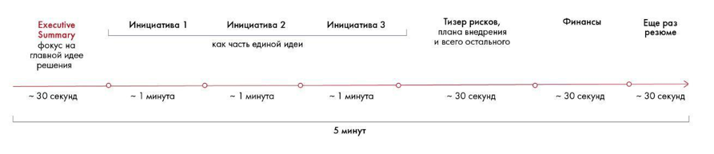

# Иллюстрация: PDF 255, изображение 1

Иллюстрация исходника: «Примерная структура 5-минутного выступления». Подписи и числовые значения вынесены в расшифровку; порядок и связи элементов проверяются по сохранённому изображению.

Источник: [PDF 255](../../SOURCE.md#pdf-255).

Необходимая тема: [Подготовка к выступлению: структура](../../chapters/12-public-speaking/01-speech.md).

## Текст изображения

> Автоматическая расшифровка. Подписи в сложных слайдах, рукописный текст и порядок колонок могут содержать ошибки OCR. Уточнения, проверенные таблицы и формулы выше имеют приоритет. Не интерпретируйте отсутствие распознанного текста как отсутствие данных в рисунке.

- Executive
- Summary
- фокус на
- главной идее
- решения
- ~ 30 секунд
- Инициатива 1
- - 1 минута
- Инициатива 2
- как часть единой идеи
- - 1 минута
- Инициатива 3
- - 1 минута
- 5 минут
- Тизер рисков,
- плана внедрения
- и всего остального
- - 30 секунд
- Финансы
- - 30 секунд
- - ще ра
- резюме
- - 30 секунд

## Связанные материалы

[Вернуться к теме](../../chapters/12-public-speaking/01-speech.md) · [Ограничения распознавания](../../meta/issues.md)
