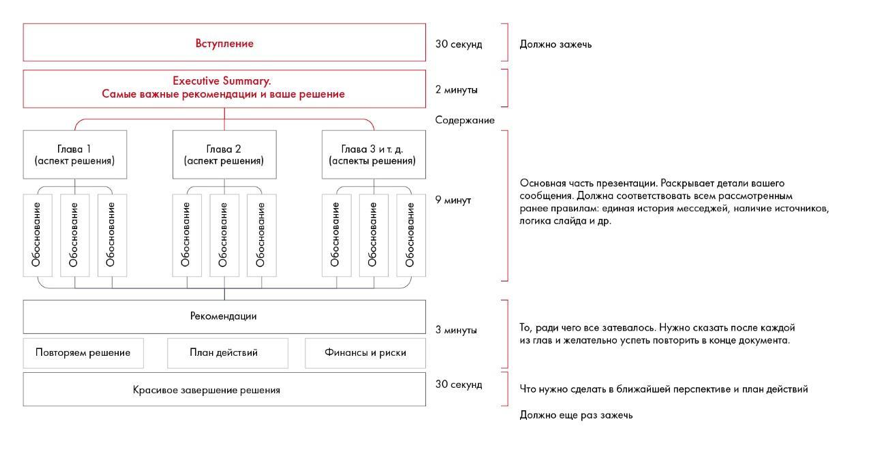

# Иллюстрация: PDF 255, изображение 2

Иллюстрация исходника: «Примерная структура 15-минутного выступления». Подписи и числовые значения вынесены в расшифровку; порядок и связи элементов проверяются по сохранённому изображению.

Источник: [PDF 255](../../SOURCE.md#pdf-255).

Необходимая тема: [Подготовка к выступлению: структура](../../chapters/12-public-speaking/01-speech.md).

## Текст изображения

> Автоматическая расшифровка. Подписи в сложных слайдах, рукописный текст и порядок колонок могут содержать ошибки OCR. Уточнения, проверенные таблицы и формулы выше имеют приоритет. Не интерпретируйте отсутствие распознанного текста как отсутствие данных в рисунке.

- Вступление
- Executive Summary.
- Самые важные рекомендации и ваше решение
- Глава 1
- (аспект решения)
- Обоснование
- Обоснование
- Обоснование
- Обоснования
- Обоснование
- (аспект решения)
- Глава 2
- Глава 3 и т. д.
- (аспекты решения)
- Обоснование
- Обосновани!
- Рекомендации
- Повторяем решение
- План действий
- Финансы и риски
- Красивое завершение решения
- 30 секунд
- 2 минуты
- Содержание
- 9 минут
- 3 минуты
- 30 секунд
- Должно зажечь
- Існовная часть презентации. Раскрывает детали вашег
- общения. Должна соответствовать всем рассмотренны!
- ранее правилам: единая история месседжей, наличие источников,
- логика слайда и др.
- онце докумен
- Что нужно сделать в ближайшей перспективе и план действий
- Должно еще раз зажечь

## Связанные материалы

[Вернуться к теме](../../chapters/12-public-speaking/01-speech.md) · [Ограничения распознавания](../../meta/issues.md)
