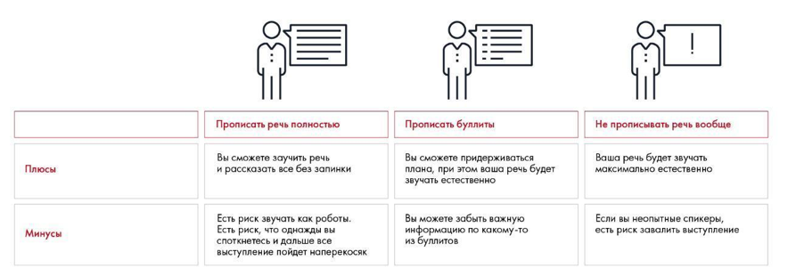

# Иллюстрация: PDF 257, изображение 2

На рисунке приведены элементы: Плюсы; Минусы; Прописать речь полностью; Вы сможете заучить речь; и рассказать все без запинки. Полная текстовая расшифровка приведена отдельно; геометрия и цветовые обозначения сохранены на изображении.

Источник: [PDF 257](../../SOURCE.md#pdf-257).

Необходимая тема: [Репетиция и раздаточные материалы](../../chapters/12-public-speaking/02-rehearsal.md).

## Текст изображения

> Автоматическая расшифровка. Подписи в сложных слайдах, рукописный текст и порядок колонок могут содержать ошибки OCR. Уточнения, проверенные таблицы и формулы выше имеют приоритет. Не интерпретируйте отсутствие распознанного текста как отсутствие данных в рисунке.

- Плюсы
- Минусы
- Прописать речь полностью
- Вы сможете заучить речь
- и рассказать все без запинки
- Прописать буллиты
- Зы сможете придерживаться
- глана, при этом ваша речь будет
- звучать естественно
- Есть риск звучать как роботы.
- Есть риск, что однажды вы
- споткнетесь и дальше все
- выступление пойдет наперекосяк
- Вы можете забыть важную
- информацию по какому-то
- из буллитов
- Не прописывать речь вообще
- Если вы неопытные спикеры,
- есть риск завалить выступление

## Связанные материалы

[Вернуться к теме](../../chapters/12-public-speaking/02-rehearsal.md) · [Ограничения распознавания](../../meta/issues.md)
