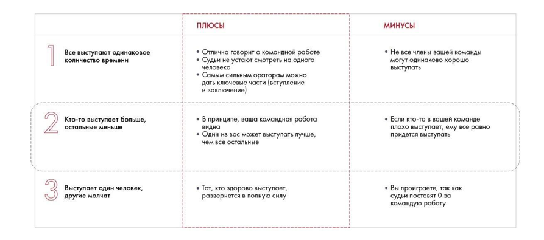

# Иллюстрация: PDF 258, изображение 1

На рисунке приведены элементы: 2; Все выступают одинаковое; количество времени; Кто-то выступает больше,; остальные меньше. Полная текстовая расшифровка приведена отдельно; геометрия и цветовые обозначения сохранены на изображении.

Источник: [PDF 258](../../SOURCE.md#pdf-258).

Необходимая тема: [Репетиция и раздаточные материалы](../../chapters/12-public-speaking/02-rehearsal.md).

## Текст изображения

> Автоматическая расшифровка. Подписи в сложных слайдах, рукописный текст и порядок колонок могут содержать ошибки OCR. Уточнения, проверенные таблицы и формулы выше имеют приоритет. Не интерпретируйте отсутствие распознанного текста как отсутствие данных в рисунке.

- 2
- Все выступают одинаковое
- количество времени
- Кто-то выступает больше,
- остальные меньше
- Выступает один человек,
- другие молчат
- ПЛЮСЫ
- • Отлично говорит о командной работе
- • Судьи не устают смотреть на одного
- человека
- • Самым сильным ораторам можно
- дать ключевые части (вступление
- и заключение)
- • В принципе, ваша командная работа
- видна
- • Один из вас может выступать лучше,
- чем все остальные
- • Тот, кто здорово выступает,
- развернется в полную силу
- МИНУСЫ
- • Не все члены вашей команды
- могут одинаково хорошо
- выступать
- • Если кто-то в вашей команде
- плохо выступает, ему все равно
- придется выступать
- • Вы проиграете, так как
- судьи поставят 0 за
- командую работу

## Связанные материалы

[Вернуться к теме](../../chapters/12-public-speaking/02-rehearsal.md) · [Ограничения распознавания](../../meta/issues.md)
