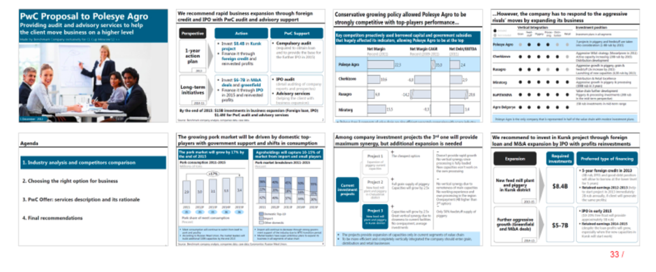

# Иллюстрация: PDF 260, изображение 1

Иллюстрация исходника: «Пример раздаточных материалов победителей кейс-чемпионата.». Подписи и числовые значения вынесены в расшифровку; порядок и связи элементов проверяются по сохранённому изображению.

Источник: [PDF 260](../../SOURCE.md#pdf-260).

Необходимая тема: [Репетиция и раздаточные материалы](../../chapters/12-public-speaking/02-rehearsal.md).

## Текст изображения

> Автоматическая расшифровка. Подписи в сложных слайдах, рукописный текст и порядок колонок могут содержать ошибки OCR. Уточнения, проверенные таблицы и формулы выше имеют приоритет. Не интерпретируйте отсутствие распознанного текста как отсутствие данных в рисунке.

- PwC Proposal to Polesye Agro
- Providing audit and advisory services to help
- the client move business on a higher level
- credit and IPO with PaC audit and adrisery support
- Conservative growing policy allowed Polesye Agro to be
- strongly competitive with top-players performance...
- Agenda
- L. Industry analysis and compectors comparison
- 2. Choosing the right option for business
- 3. PrC Offer: services description and its rationale
- 4. Final recommendations
- pork market will be driven by 4
- _However, the company has to respond to the aggressive
- ... ..
- Pings ago
- taug
- Among company investment projects the 3'° one will provide
- maximum synergy but adde
- nal expansion is needed
- ......
- loan and M& exparsion by IPO with profits reinvestments
- Palemed type of forcing
- Nina feed wit plan
- $8.48
- • IP0 in saty HIS
- $5-78
- and Mit deale
- 33/

## Связанные материалы

[Вернуться к теме](../../chapters/12-public-speaking/02-rehearsal.md) · [Ограничения распознавания](../../meta/issues.md)
