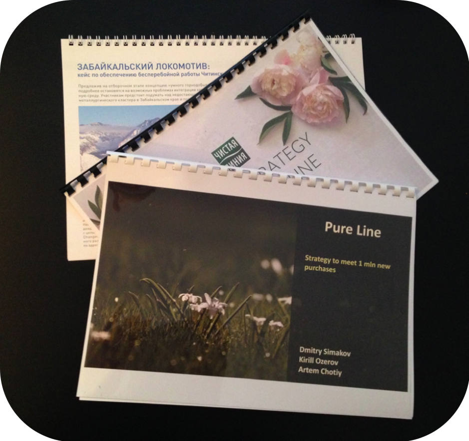

# Иллюстрация: PDF 261, изображение 1

На рисунке приведены элементы: ЗАБАЙКАЛЬСКИЙ ЛОКОМОТИВ:; кейс по обеспечению бесперебойной работы Чити; Предложив на отборочном зіале к01; ЧИСТАЯ; PATEGY. Полная текстовая расшифровка приведена отдельно; геометрия и цветовые обозначения сохранены на изображении.

Источник: [PDF 261](../../SOURCE.md#pdf-261).

Необходимая тема: [Репетиция и раздаточные материалы](../../chapters/12-public-speaking/02-rehearsal.md).

## Текст изображения

> Автоматическая расшифровка. Подписи в сложных слайдах, рукописный текст и порядок колонок могут содержать ошибки OCR. Уточнения, проверенные таблицы и формулы выше имеют приоритет. Не интерпретируйте отсутствие распознанного текста как отсутствие данных в рисунке.

- ЗАБАЙКАЛЬСКИЙ ЛОКОМОТИВ:
- кейс по обеспечению бесперебойной работы Чити
- Предложив на отборочном зіале к01
- ЧИСТАЯ
- PATEGY
- INE
- Pure Line
- Strategy to meet 1 min new
- purchases
- Dmitry Simakov
- Kirill Ozerov
- Artem Chotiy

## Связанные материалы

[Вернуться к теме](../../chapters/12-public-speaking/02-rehearsal.md) · [Ограничения распознавания](../../meta/issues.md)
