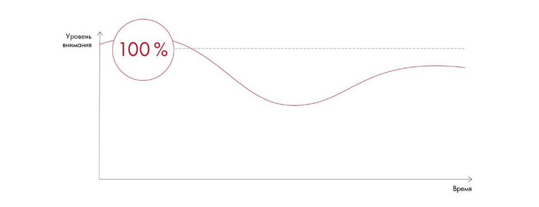

# Иллюстрация: PDF 262, изображение 1

Кривая внимания аудитории: высокая вовлечённость в начале, снижение в середине и подъём к завершению. Рисунок объясняет значение вступления, смысловых акцентов и финала.

Источник: [PDF 262](../../SOURCE.md#pdf-262).

Необходимая тема: [Выступление: внимание, голос и невербальные приёмы](../../chapters/12-public-speaking/03-delivery.md).

## Текст изображения

> Автоматическая расшифровка. Подписи в сложных слайдах, рукописный текст и порядок колонок могут содержать ошибки OCR. Уточнения, проверенные таблицы и формулы выше имеют приоритет. Не интерпретируйте отсутствие распознанного текста как отсутствие данных в рисунке.

- Уровень
- внимания
- 100%
- Время

## Связанные материалы

[Вернуться к теме](../../chapters/12-public-speaking/03-delivery.md) · [Ограничения распознавания](../../meta/issues.md)
