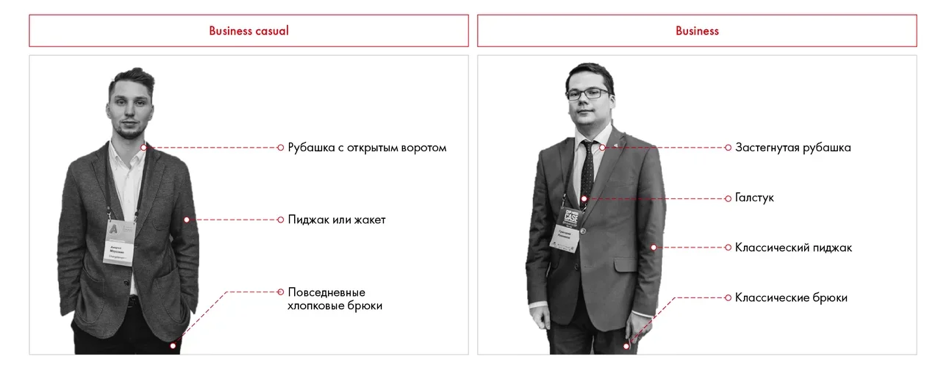

# Иллюстрация: PDF 263, изображение 1

Иллюстрация исходника: «Примеры дресс-кода». Подписи и числовые значения вынесены в расшифровку; порядок и связи элементов проверяются по сохранённому изображению.

Источник: [PDF 263](../../SOURCE.md#pdf-263).

Необходимая тема: [Выступление: внимание, голос и невербальные приёмы](../../chapters/12-public-speaking/03-delivery.md).

## Текст изображения

> Автоматическая расшифровка. Подписи в сложных слайдах, рукописный текст и порядок колонок могут содержать ошибки OCR. Уточнения, проверенные таблицы и формулы выше имеют приоритет. Не интерпретируйте отсутствие распознанного текста как отсутствие данных в рисунке.

- Business casual
- Business
- о Рубашка с открытым воротом
- о Застегнутая рубашка
- •о Галстук
- - о Пиджак или жакет
- о Классический пиджак
- • Повседневные
- хлопковые брюки
- о Классические брюки

## Связанные материалы

[Вернуться к теме](../../chapters/12-public-speaking/03-delivery.md) · [Ограничения распознавания](../../meta/issues.md)
