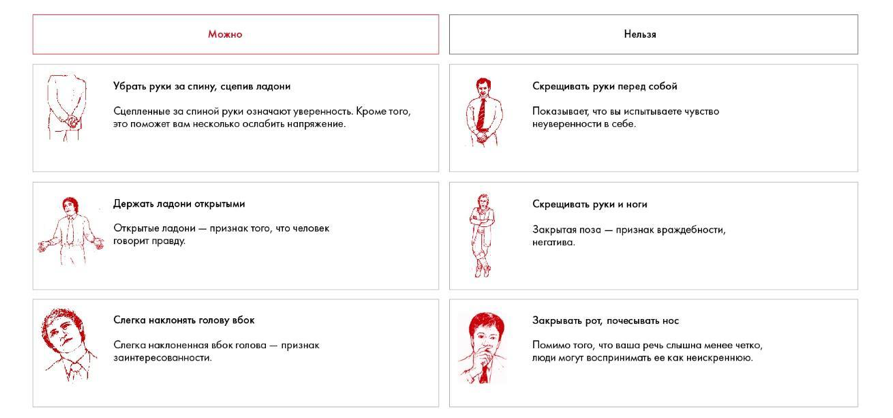

# Иллюстрация: PDF 266, изображение 1

Иллюстрация исходника: «Примеры закрытых и открытых поз». Подписи и числовые значения вынесены в расшифровку; порядок и связи элементов проверяются по сохранённому изображению.

Источник: [PDF 266](../../SOURCE.md#pdf-266).

Необходимая тема: [Выступление: внимание, голос и невербальные приёмы](../../chapters/12-public-speaking/03-delivery.md).

## Текст изображения

> Автоматическая расшифровка. Подписи в сложных слайдах, рукописный текст и порядок колонок могут содержать ошибки OCR. Уточнения, проверенные таблицы и формулы выше имеют приоритет. Не интерпретируйте отсутствие распознанного текста как отсутствие данных в рисунке.

- Можно
- Убрать руки за спину, сцепив ладони
- Сцепленные за спиной руки означают уверенность. Кроме того,
- это поможет вам несколько ослабить напряжение.
- Держать ладони открытыми
- Открытые ладони - признак того, что человек
- говорит правду.
- Слегка наклонять голову вбок
- Слегка наклоненная вбок голова - признак
- заинтересованности.
- Нельзя
- Скрещивать руки перед собой
- Показывает, что вы испытываете чувство
- неуверенности в себе.
- Скрещивать руки и ноги
- Закрытая поза - признак враждебности,
- негатива.
- Закрывать рот, почесывать нос
- Помимо того, что ваша речь слышна менее четко
- люди могут воспринимать ее как неискреннюю.

## Связанные материалы

[Вернуться к теме](../../chapters/12-public-speaking/03-delivery.md) · [Ограничения распознавания](../../meta/issues.md)
