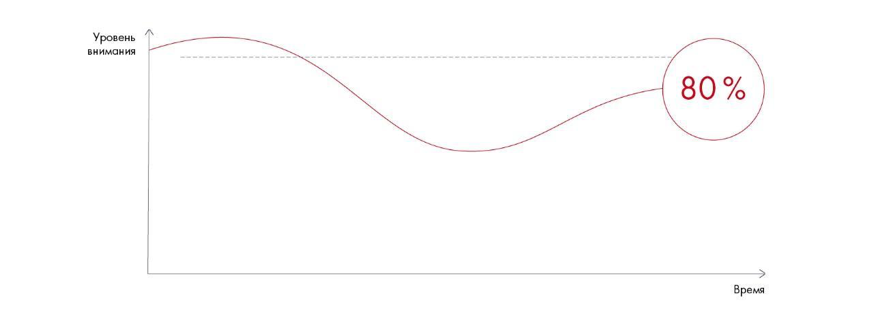

# Иллюстрация: PDF 268, изображение 1

Кривая внимания с дополнительными пиками после приёмов активизации аудитории. График иллюстрирует необходимость периодически возвращать внимание слушателей.

Источник: [PDF 268](../../SOURCE.md#pdf-268).

Необходимая тема: [Выступление: внимание, голос и невербальные приёмы](../../chapters/12-public-speaking/03-delivery.md).

## Текст изображения

> Автоматическая расшифровка. Подписи в сложных слайдах, рукописный текст и порядок колонок могут содержать ошибки OCR. Уточнения, проверенные таблицы и формулы выше имеют приоритет. Не интерпретируйте отсутствие распознанного текста как отсутствие данных в рисунке.

- Уровень/
- внимания
- 80%
- Время

## Связанные материалы

[Вернуться к теме](../../chapters/12-public-speaking/03-delivery.md) · [Ограничения распознавания](../../meta/issues.md)
