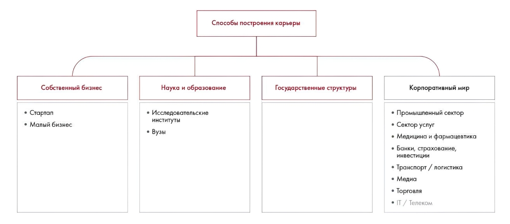

# Иллюстрация: PDF 275, изображение 1

На рисунке приведены элементы: Собственный бизнес; • Стартап; • Малый бизнес; Способы построения карьеры; Наука и образование. Полная текстовая расшифровка приведена отдельно; геометрия и цветовые обозначения сохранены на изображении.

Источник: [PDF 275](../../SOURCE.md#pdf-275).

Необходимая тема: [Ответы: неделя 5](../../chapters/13-answers/03-week-05.md).

## Текст изображения

> Автоматическая расшифровка. Подписи в сложных слайдах, рукописный текст и порядок колонок могут содержать ошибки OCR. Уточнения, проверенные таблицы и формулы выше имеют приоритет. Не интерпретируйте отсутствие распознанного текста как отсутствие данных в рисунке.

- Собственный бизнес
- • Стартап
- • Малый бизнес
- Способы построения карьеры
- Наука и образование
- Государственные структуры
- • Исследовательские
- институты
- • Вузы
- Корпоративный мир
- • Промышленный сектор
- • Сектор услуг
- • Медицина и фармацевтика
- • Банки, страхование,
- инвестиции
- • Транспорт / логистика
- • Медиа
- • Торговля
- • ІТ / Телеком

## Связанные материалы

[Вернуться к теме](../../chapters/13-answers/03-week-05.md) · [Ограничения распознавания](../../meta/issues.md)
