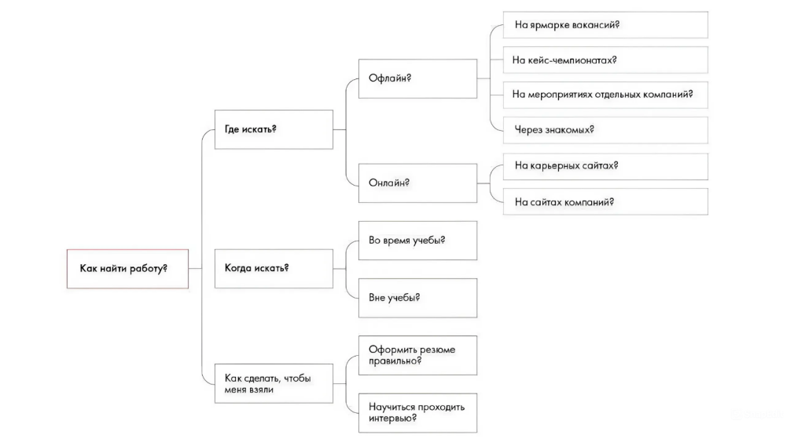

# Иллюстрация: PDF 275, изображение 2

На рисунке приведены элементы: Как найти работу?; Где искать?; Когда искать?; Как сделать, чтобы; меня взяли. Полная текстовая расшифровка приведена отдельно; геометрия и цветовые обозначения сохранены на изображении.

Источник: [PDF 275](../../SOURCE.md#pdf-275).

Необходимая тема: [Ответы: неделя 5](../../chapters/13-answers/03-week-05.md).

## Текст изображения

> Автоматическая расшифровка. Подписи в сложных слайдах, рукописный текст и порядок колонок могут содержать ошибки OCR. Уточнения, проверенные таблицы и формулы выше имеют приоритет. Не интерпретируйте отсутствие распознанного текста как отсутствие данных в рисунке.

- Как найти работу?
- Где искать?
- Когда искать?
- Как сделать, чтобы
- меня взяли
- На ярмарке вакансий?
- На кейс-чемпионатах?
- Офлайн?
- На мероприятиях отдельных компаний?
- Онлайн?
- Через знакомых?
- На карьерных сайтах?
- На сайтах компаний?
- Во время учебы?
- Вне учебы?
- формить резюл
- равильно
- Научиться проходить
- интервью€

## Связанные материалы

[Вернуться к теме](../../chapters/13-answers/03-week-05.md) · [Ограничения распознавания](../../meta/issues.md)
