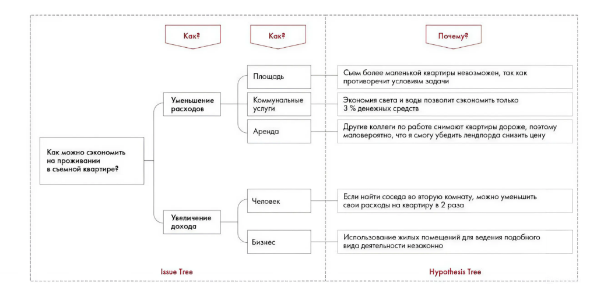

# Иллюстрация: PDF 279, изображение 1

На рисунке приведены элементы: Как?; Уменьшение; расходов; Как можно сэкономить; на проживании. Полная текстовая расшифровка приведена отдельно; геометрия и цветовые обозначения сохранены на изображении.

Источник: [PDF 279](../../SOURCE.md#pdf-279).

Необходимая тема: [Ответы: неделя 5](../../chapters/13-answers/03-week-05.md).

## Текст изображения

> Автоматическая расшифровка. Подписи в сложных слайдах, рукописный текст и порядок колонок могут содержать ошибки OCR. Уточнения, проверенные таблицы и формулы выше имеют приоритет. Не интерпретируйте отсутствие распознанного текста как отсутствие данных в рисунке.

- Как?
- Уменьшение
- расходов
- Как можно сэкономить
- на проживании
- в съемной квартире?
- Увеличение
- дохода
- Issue Tree
- Как?
- Площадь
- Коммунальные
- услуги
- Аренда
- Человек
- Бизнес
- Почему?
- Сьем более маленькой квартиры невозможен, так кок
- противоречит условиям задачи
- Экономия света и воды позволит сэкономить только
- 3 % денежных средств
- Другие коллеги по работе снимают квартиры дороже, поэтому
- маловероятно, что я смогу убедить лендлорда снизить цену
- Если найти соседа во вторую комнату, можно уменьшить
- свои расходы на квартиру в 2 раза
- Использование жилых помещений для ведения подобного
- вида деятельности незаконно
- Hypothesis Tree

## Связанные материалы

[Вернуться к теме](../../chapters/13-answers/03-week-05.md) · [Ограничения распознавания](../../meta/issues.md)
